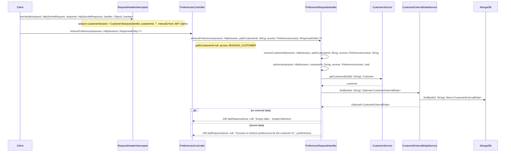
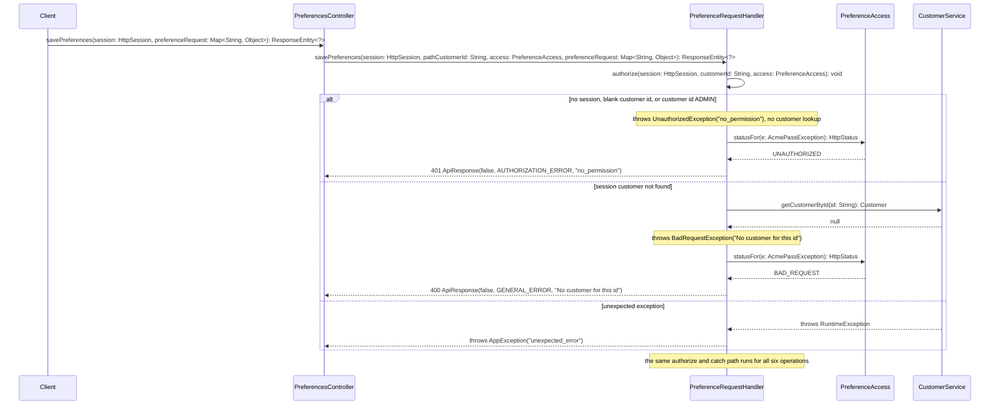
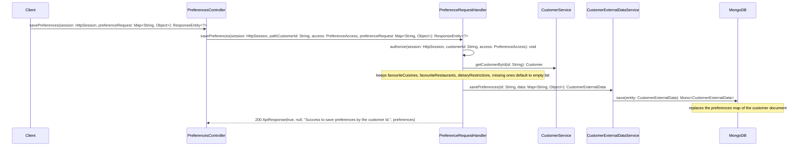
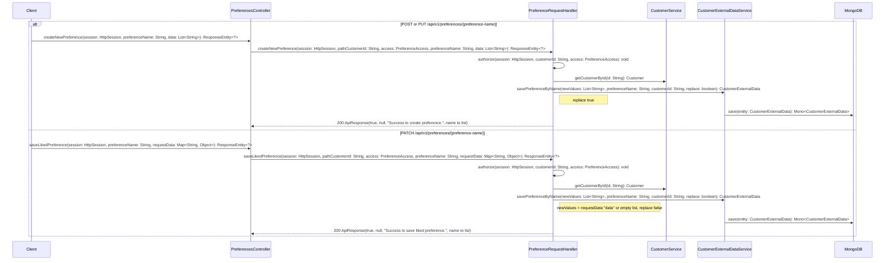
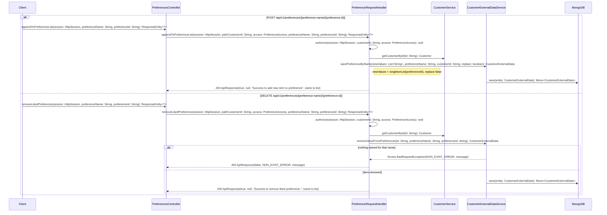
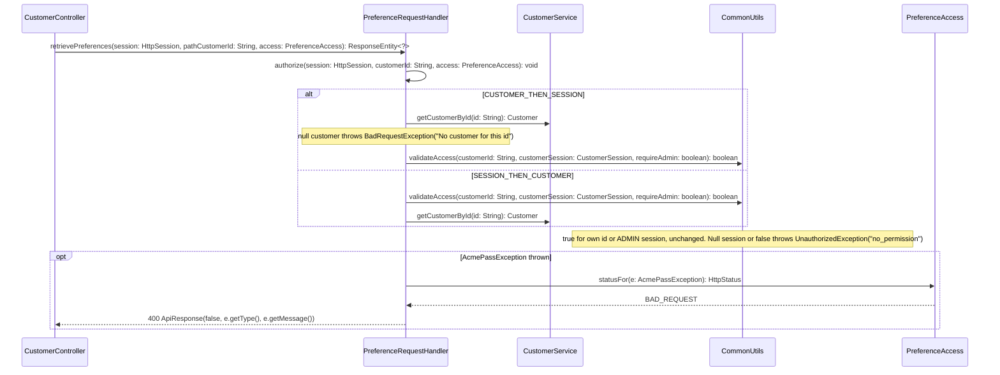
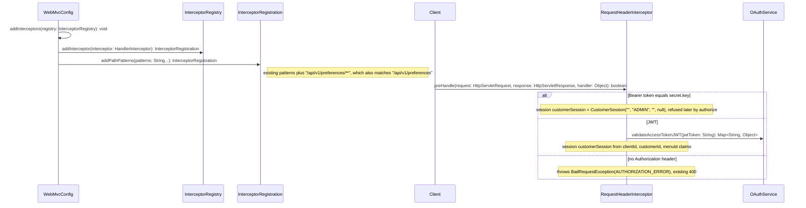

# Implementation plan: move customer preferences to /api/v1/preferences

## Summary

Web and app clients edit a signed-in customer's preferences through six handlers under `/api/v1/customers/{customer-id}/preferences...` in `CustomerController`.
The path id duplicates what the access token already says, and the six handlers copy the same guard and catch blocks.
This plan adds a `PreferencesController` at `api/v1/preferences` that takes the customer id from the `CustomerSession` alone.
The six handler bodies move once into a new `PreferenceRequestHandler`, which both controllers call. A fix there lands on old and new paths.
A `PreferenceAccess` enum names the three guard modes: the two orders the old handlers use, and the new session-only mode.
Session-only mode refuses a missing session, a blank customer id and the `ADMIN` session with `UnauthorizedException`, then loads the customer.
The new endpoints answer 401 for that refusal, with the old `no_permission` body. The old endpoints keep answering 400.
The interceptor that builds `CustomerSession` gets `/api/v1/preferences/**` added. Without it the new API has no session.
Old handlers keep their signatures, check order, admin pass-through, messages and log text. `CustomerControllerPreferencesTest` stays byte-identical and proves it.
No schema change, no new dependency. The work lands as four stacked PRs, each under 500 changed lines.

## Scope

In:

- `PreferenceAccess` enum and `PreferenceRequestHandler` component holding the six operations, the guard, and the catch blocks.
- The six existing `CustomerController` preference handlers reduced to one-line delegations.
- A new `PreferencesController` with the six endpoints from the requirement table.
- `WebMvcConfig.addInterceptors` registering `RequestHeaderInterceptor` for `/api/v1/preferences/**`.
- Unit tests: a new controller test with old-versus-new parity cases, a handler test for the guard modes, and one extra case in `WebAndSecurityConfigTest`.

Out:

- Removing or deprecating the old endpoints (later ticket).
- The seventh handler `GET /api/v1/customers/{customer-id}/preferences/{preference-name}` (`retrieveLikedPreference`, `CustomerController.java:1479`). It is not in the requirement's table, so it stays as is and is not routed under the new API.
- Any change to `CustomerExternalDataService`, `CommonUtils.validateAccess` or `RequestHeaderInterceptor` logic.
- Aligning the old endpoints' 400-for-unauthorized with 401.

Assumptions:

- The repo builds on Java 21 and Spring Boot 2.7.18 (`build.gradle`, repo profile), not the Java 11 / Boot 2.4.1 the requirement states. New code avoids post-11 syntax (no records, switch expressions or `instanceof` patterns), so either baseline compiles it (planner's call).
- The admin secret token reaches the handler as `CustomerSession("", "ADMIN", "", null)` (`RequestHeaderInterceptor.java:47-51`), so the new admin rule is enforced in the handler, not in the interceptor (planner's call).
- "Missing session" in the requirement means no `customerSession` attribute when the handler runs. Over HTTP the interceptor answers a missing `Authorization` header first, with its existing 400 `AUTHORIZATION_ERROR`, and an invalid JWT with its existing 401 (planner's call).

## Design

Source: planner's draft

Approach: Model the guard as data first. `PreferenceAccess` has three values. `CUSTOMER_THEN_SESSION` covers the five old handlers that load the customer and then call `CommonUtils.validateAccess`. `SESSION_THEN_CUSTOMER` covers old `createNewPreference`, which checks first. `SESSION_CUSTOMER` is the new token-only mode. `PreferenceRequestHandler` takes `(session, pathCustomerId, access, ...)`. It resolves the customer id (the path id, or the session id for `SESSION_CUSTOMER`) before its `try`, so the log lines keep a `customerId`. It then runs `authorize` and the old operation body inside the `try`. Its two catch blocks are copied verbatim, with one change: the error status comes from `access.statusFor(e)`. That returns `UNAUTHORIZED` only for `SESSION_CUSTOMER` with an `UnauthorizedException`, and `BAD_REQUEST` otherwise. Each controller method becomes one delegation line. The old ones pass their path id and old mode. The new ones pass `null` and `SESSION_CUSTOMER`. The handler sits in `com.pass.acme.controller` because it builds `ResponseEntity`/`ApiResponse`. It is a `@Component` with `@RequiredArgsConstructor`, after `CustomerDeleteHelper`'s pattern. `CustomerController` gets it by `@Autowired` field, its existing style, so `CustomerControllerTestSupport` needs one `set(...)` line. Stack order for the splitter (principle 1): PR-1 adds the enum and handler with the two collection operations and rewires old `savePreferences`/`retrievePreferences`. PR-2 does the two `{preference-name}` operations, PR-3 the two `{preference-id}` operations. PR-4 adds `PreferencesController`, the interceptor pattern and the new tests. Each of PR-1 to PR-3 keeps the untouched `CustomerControllerPreferencesTest` green, which is the "no behaviour change" proof. Each one also covers the moved lines, so the jacoco floor holds.

Alternatives rejected:

| Alternative | Why not |
|---|---|
| New controller calls `CustomerController` handlers with the session id as the path id | Inherits `validateAccess` admitting `ADMIN` and the customer-first order, both of which the requirement changes. Couples two controllers. |
| Copy the six bodies into `PreferencesController` with a new guard | Two copies of every message and catch block. The requirement says a fix must land once. |
| Change the old handlers to the new session-first, admin-rejecting guard | Changes old behaviour that `CustomerControllerPreferencesTest` asserts, e.g. admin reads at `:151`. |
| Shared logic in a `*Service` returning domain values, with each controller building responses | Response messages and catch blocks would still be duplicated across controllers. Those are most of the 33-line bodies. |
| Pass the guard as a `Runnable` lambda | Hides the three modes in call sites. An enum is testable and lets `statusFor` carry the 401 rule. |
| Reject `ADMIN` in `RequestHeaderInterceptor` for `/api/v1/preferences/**` | Puts route-specific policy in a shared interceptor and returns a different body than the existing handler path. |

## Grounding

Pointers:

- `src/main/java/com/pass/acme/controller/CustomerController.java:83` class header, `@RestController @RequestMapping("api/v1/customers") @Log4j2`, field injection.
- `src/main/java/com/pass/acme/controller/CustomerController.java:98` `@Autowired private CustomerService customerService`.
- `src/main/java/com/pass/acme/controller/CustomerController.java:160` `@Autowired private CustomerExternalDataService customerExternalDataService`.
- `src/main/java/com/pass/acme/controller/CustomerController.java:1245` the TODO this ticket resolves (the requirement cites `:1233`).
- `src/main/java/com/pass/acme/controller/CustomerController.java:1246` `savePreferences`, customer then session.
- `src/main/java/com/pass/acme/controller/CustomerController.java:1277` `retrievePreferences`, customer then session, "Empty data." branch.
- `src/main/java/com/pass/acme/controller/CustomerController.java:1310` `createNewPreference`, POST and PUT, session then customer, `replace = true`.
- `src/main/java/com/pass/acme/controller/CustomerController.java:1340` `saveLikedPreference`, PATCH, customer then session, `requestData.getOrDefault("data", ...)`, `replace = false`.
- `src/main/java/com/pass/acme/controller/CustomerController.java:1371` `appendToPreferenceList`, customer then session.
- `src/main/java/com/pass/acme/controller/CustomerController.java:1405` `removeLikedPreference`, customer then session.
- `src/main/java/com/pass/acme/controller/CustomerController.java:1479` `retrieveLikedPreference`, the out-of-scope seventh handler.
- `src/main/java/com/pass/acme/util/CommonUtils.java:257` `validateAccess(String, CustomerSession, boolean): boolean`. It returns true for an `ADMIN` session and NPEs on a null session customer id.
- `src/main/java/com/pass/acme/service/CustomerService.java:403` `getCustomerById(String): Customer`, null when absent, MySQL via `ICustomerRepository`.
- `src/main/java/com/pass/acme/service/CustomerExternalDataService.java:49` `findById(String): Optional<CustomerExternalData>`, reactive Mongo with 3 s timeout and retry.
- `src/main/java/com/pass/acme/service/CustomerExternalDataService.java:102` `savePreferences(String, Map<String, Object>): CustomerExternalData`.
- `src/main/java/com/pass/acme/service/CustomerExternalDataService.java:113` `savePreferenceByName(List<String>, String, String, boolean): CustomerExternalData`.
- `src/main/java/com/pass/acme/service/CustomerExternalDataService.java:130` `removeValueFromPreferences(String, String, String): CustomerExternalData`. It throws `BadRequestException(NON_EXIST_ERROR, ...)` when there is nothing to remove.
- `src/main/java/com/pass/acme/security/RequestHeaderInterceptor.java:36` `preHandle`. `:47-51` builds the admin `CustomerSession`, and `:56-65` builds the JWT session.
- `src/main/java/com/pass/acme/config/WebMvcConfig.java:65` `addInterceptors`. `/api/v1/preferences/**` is absent from the `:66` path patterns.
- `src/main/java/com/pass/acme/service/OAuthService.java:47` `TAG_CUSTOMER_SESSION = "customerSession"`.
- `src/main/java/com/pass/acme/exception/UnauthorizedException.java:6` `@ResponseStatus(UNAUTHORIZED)` and `:8` `UNAUTHORIZED_MESSAGE = "no_permission"`.
- `src/main/java/com/pass/acme/util/ExceptionHandlerAspect.java:28` `@AfterThrowing` on `controller.*Controller` and `service.*Service`. It logs only non-`AcmePassException` throwables, so `PreferencesController` is covered and the handler needs no aspect.
- `src/main/java/com/pass/acme/service/CustomerDeleteHelper.java:10` precedent for a shared `@Component` with `@Log4j2`.
- `src/main/java/com/pass/acme/controller/ClientController.java:25` precedent for `@RequiredArgsConstructor` with final fields, tested via `new ClientController(mock)`.
- `src/main/java/com/pass/acme/controller/MetadataController.java:68` precedent for a token-only `@PostMapping("")`.
- `src/test/java/com/pass/acme/controller/CustomerControllerTestSupport.java:106` `wireController()` builds `new CustomerController()` and sets fields with `ReflectionTestUtils`. `:159` `signedInAs`.
- `src/test/java/com/pass/acme/controller/CustomerControllerPreferencesTest.java:79` `assertGuarded`, the old access matrix. `:64` `assertUnauthorized` expects 400 plus `AUTHORIZATION_ERROR`.
- `src/test/java/com/pass/acme/config/WebAndSecurityConfigTest.java:90` `headerInterceptorGuardsCustomerAndAdminRoutesExceptThePublicOnes`.

Conventions:

- Controllers take `HttpSession session` and read `(CustomerSession) session.getAttribute(OAuthService.TAG_CUSTOMER_SESSION)`. Nothing uses `@RequestAttribute` or `@SessionAttribute`.
- Handled errors: `catch (AcmePassException e)` does `log.warn(...)`, then returns a 400 `new ApiResponse(false, e.getType(), e.getMessage())`. `catch (Exception e)` does `log.error(..., e)` and throws `new AppException(UNHANDLED_ERROR_MESSAGE)`, which becomes a 500. No `@ControllerAdvice` exists.
- Logging is Lombok `@Log4j2`. `ApiResponse` has constructors only.
- Base paths are written without a leading slash: `@RequestMapping("api/v1/...")`.
- Tests use JUnit 5, `MockitoExtension` with `LENIENT` and package-private classes. Nested groups have one `@Nested` class per endpoint, and cases are named like `ownSession_...` and `accessRules`. There is no Spring context, and the jacoco line floor is 0.98.

Commands:

- Test: `./gradlew check --no-daemon` (single class: `./gradlew test --tests 'com.pass.acme.controller.PreferencesControllerTest'`, after sourcing the JDK 21 `env.sh` from the profile caveats)
- Lint: none in this repo.
- Build: `./gradlew build -x test`

## Data shapes

- `PreferenceAccess` (new enum, `com.pass.acme.controller`). The organising structure is a three-value enum because the guard has exactly three fixed shapes, and the HTTP status rule hangs off the same value.

  | Value | Customer id used | Check order | `ADMIN` session | Unauthorized status |
  |---|---|---|---|---|
  | `CUSTOMER_THEN_SESSION` | path id | `getCustomerById`, then `validateAccess(id, session, false)` | allowed (unchanged) | 400 |
  | `SESSION_THEN_CUSTOMER` | path id | `validateAccess`, then `getCustomerById` | allowed (unchanged) | 400 |
  | `SESSION_CUSTOMER` | `CustomerSession.customerId` | session present, id non-blank, id not `ADMIN` (ignore case, as `CommonUtils` does), then `getCustomerById` | refused | 401 |

  `statusFor(AcmePassException e): HttpStatus` returns `UNAUTHORIZED` when `this == SESSION_CUSTOMER && e instanceof UnauthorizedException`, and `BAD_REQUEST` otherwise.
- Request and response payloads are unchanged. Bodies are `Map<String, Object>` (collection POST, PATCH), `List<String>` (POST/PUT by name) or none. Responses are `ApiResponse(success, type, message, data)` with the old message strings verbatim.
- Error bodies on the new endpoints: refused session gives 401 `ApiResponse(false, AUTHORIZATION_ERROR, "no_permission")`. An unknown customer gives 400 `ApiResponse(false, GENERAL_ERROR, "No customer for this id")`. Nothing to remove gives 400 with the service's `NON_EXIST_ERROR` message. An unexpected error throws `AppException("unexpected_error")`, which becomes a 500.

## Sequence diagrams

### SD-1: Retrieve preferences from the access token

New: `PreferencesController.retrievePreferences`, `PreferenceRequestHandler.retrievePreferences`, `PreferenceRequestHandler.resolveCustomerId`, `PreferenceRequestHandler.authorize`.

### SD-2: Refuse a bad session or unknown customer on the new endpoints

New: `PreferenceAccess.statusFor`, `PreferencesController.savePreferences`, `PreferenceRequestHandler.savePreferences`.

### SD-3: Save the preference collection from the access token

### SD-4: Replace or merge one named preference

New: `PreferencesController.createNewPreference`, `PreferencesController.saveLikedPreference`, `PreferenceRequestHandler.createNewPreference`, `PreferenceRequestHandler.saveLikedPreference`.

### SD-5: Append or remove one preference item

New: `PreferencesController.appendToPreferenceList`, `PreferencesController.removeLikedPreference`, `PreferenceRequestHandler.appendToPreferenceList`, `PreferenceRequestHandler.removeLikedPreference`.

### SD-6: Old path-id endpoints delegate to the shared handler

```mermaid
sequenceDiagram
  participant Client
  participant CustomerController
  participant PreferenceRequestHandler
  Client->>CustomerController: savePreferences(session: HttpSession, request: HttpServletRequest, response: HttpServletResponse, customerId: String, preferenceRequest: Map<String, Object>): ResponseEntity<?>
  CustomerController->>PreferenceRequestHandler: savePreferences(session: HttpSession, pathCustomerId: String, access: PreferenceAccess, preferenceRequest: Map<String, Object>): ResponseEntity<?>
  Client->>CustomerController: retrievePreferences(session: HttpSession, request: HttpServletRequest, response: HttpServletResponse, customerId: String): ResponseEntity<?>
  CustomerController->>PreferenceRequestHandler: retrievePreferences(session: HttpSession, pathCustomerId: String, access: PreferenceAccess): ResponseEntity<?>
  Client->>CustomerController: createNewPreference(session: HttpSession, request: HttpServletRequest, response: HttpServletResponse, customerId: String, preferenceName: String, data: List<String>): ResponseEntity<?>
  CustomerController->>PreferenceRequestHandler: createNewPreference(session: HttpSession, pathCustomerId: String, access: PreferenceAccess, preferenceName: String, data: List<String>): ResponseEntity<?>
  Note right of CustomerController: createNewPreference passes SESSION_THEN_CUSTOMER, the other five pass CUSTOMER_THEN_SESSION
  Client->>CustomerController: saveLikedPreference(session: HttpSession, request: HttpServletRequest, response: HttpServletResponse, customerId: String, preferenceName: String, requestData: Map<String, Object>): ResponseEntity<?>
  CustomerController->>PreferenceRequestHandler: saveLikedPreference(session: HttpSession, pathCustomerId: String, access: PreferenceAccess, preferenceName: String, requestData: Map<String, Object>): ResponseEntity<?>
  Client->>CustomerController: appendToPreferenceList(session: HttpSession, request: HttpServletRequest, response: HttpServletResponse, customerId: String, preferenceName: String, preferenceId: String): ResponseEntity<?>
  CustomerController->>PreferenceRequestHandler: appendToPreferenceList(session: HttpSession, pathCustomerId: String, access: PreferenceAccess, preferenceName: String, preferenceId: String): ResponseEntity<?>
  Client->>CustomerController: removeLikedPreference(session: HttpSession, request: HttpServletRequest, response: HttpServletResponse, customerId: String, preferenceName: String, preferenceId: String): ResponseEntity<?>
  CustomerController->>PreferenceRequestHandler: removeLikedPreference(session: HttpSession, pathCustomerId: String, access: PreferenceAccess, preferenceName: String, preferenceId: String): ResponseEntity<?>
  Note over CustomerController: mappings, signatures and path variables unchanged, bodies become one return line each
```

### SD-7: Check access the old way for path-id requests

### SD-8: Route /api/v1/preferences through the header interceptor

## Change table

| ID | File | Class | Method | Change | Responsibility | Diagrams |
|---|---|---|---|---|---|---|
| C-1 | src/main/java/com/pass/acme/controller/PreferenceAccess.java | PreferenceAccess | statusFor(e: AcmePassException): HttpStatus | add | Enum of the three guard modes. 401 only for `SESSION_CUSTOMER` with `UnauthorizedException`, 400 otherwise. | SD-2, SD-7 |
| C-2 | src/main/java/com/pass/acme/controller/PreferenceRequestHandler.java | PreferenceRequestHandler | - | add | `@Component @Log4j2 @RequiredArgsConstructor` with final `CustomerService` and `CustomerExternalDataService`, home of the shared preference logic. | SD-1, SD-6 |
| C-3 | src/main/java/com/pass/acme/controller/PreferenceRequestHandler.java | PreferenceRequestHandler | resolveCustomerId(session: HttpSession, pathCustomerId: String, access: PreferenceAccess): String | add | Path id for old modes. Session customer id, or null when there is no session, for `SESSION_CUSTOMER`. | SD-1 |
| C-4 | src/main/java/com/pass/acme/controller/PreferenceRequestHandler.java | PreferenceRequestHandler | authorize(session: HttpSession, customerId: String, access: PreferenceAccess): void | add | Run the mode's checks in order and throw `UnauthorizedException` or `BadRequestException("No customer for this id")`. | SD-1, SD-2, SD-7 |
| C-5 | src/main/java/com/pass/acme/controller/PreferenceRequestHandler.java | PreferenceRequestHandler | savePreferences(session: HttpSession, pathCustomerId: String, access: PreferenceAccess, preferenceRequest: Map<String, Object>): ResponseEntity<?> | add | Old `savePreferences` body and catch blocks, with status from `statusFor`. | SD-2, SD-3, SD-6 |
| C-6 | src/main/java/com/pass/acme/controller/PreferenceRequestHandler.java | PreferenceRequestHandler | retrievePreferences(session: HttpSession, pathCustomerId: String, access: PreferenceAccess): ResponseEntity<?> | add | Old `retrievePreferences` body including the "Empty data." branch. | SD-1, SD-6, SD-7 |
| C-7 | src/main/java/com/pass/acme/controller/PreferenceRequestHandler.java | PreferenceRequestHandler | createNewPreference(session: HttpSession, pathCustomerId: String, access: PreferenceAccess, preferenceName: String, data: List<String>): ResponseEntity<?> | add | Old `createNewPreference` body, `replace = true`. | SD-4, SD-6 |
| C-8 | src/main/java/com/pass/acme/controller/PreferenceRequestHandler.java | PreferenceRequestHandler | saveLikedPreference(session: HttpSession, pathCustomerId: String, access: PreferenceAccess, preferenceName: String, requestData: Map<String, Object>): ResponseEntity<?> | add | Old `saveLikedPreference` body, `data` key or empty list, `replace = false`. | SD-4, SD-6 |
| C-9 | src/main/java/com/pass/acme/controller/PreferenceRequestHandler.java | PreferenceRequestHandler | appendToPreferenceList(session: HttpSession, pathCustomerId: String, access: PreferenceAccess, preferenceName: String, preferenceId: String): ResponseEntity<?> | add | Old `appendToPreferenceList` body. | SD-5, SD-6 |
| C-10 | src/main/java/com/pass/acme/controller/PreferenceRequestHandler.java | PreferenceRequestHandler | removeLikedPreference(session: HttpSession, pathCustomerId: String, access: PreferenceAccess, preferenceName: String, preferenceId: String): ResponseEntity<?> | add | Old `removeLikedPreference` body, service `NON_EXIST_ERROR` surfaced as 400. | SD-5, SD-6 |
| C-11 | src/main/java/com/pass/acme/controller/CustomerController.java | CustomerController | - | modify | Add `@Autowired private PreferenceRequestHandler preferenceRequestHandler`. Replace the `:1245` TODO with a pointer to `PreferencesController`. | SD-6 |
| C-12 | src/main/java/com/pass/acme/controller/CustomerController.java | CustomerController | savePreferences(session: HttpSession, request: HttpServletRequest, response: HttpServletResponse, customerId: String, preferenceRequest: Map<String, Object>): ResponseEntity<?> | modify | Delegate with `CUSTOMER_THEN_SESSION`. | SD-6 |
| C-13 | src/main/java/com/pass/acme/controller/CustomerController.java | CustomerController | retrievePreferences(session: HttpSession, request: HttpServletRequest, response: HttpServletResponse, customerId: String): ResponseEntity<?> | modify | Delegate with `CUSTOMER_THEN_SESSION`. | SD-6, SD-7 |
| C-14 | src/main/java/com/pass/acme/controller/CustomerController.java | CustomerController | createNewPreference(session: HttpSession, request: HttpServletRequest, response: HttpServletResponse, customerId: String, preferenceName: String, data: List<String>): ResponseEntity<?> | modify | Delegate with `SESSION_THEN_CUSTOMER`. | SD-6 |
| C-15 | src/main/java/com/pass/acme/controller/CustomerController.java | CustomerController | saveLikedPreference(session: HttpSession, request: HttpServletRequest, response: HttpServletResponse, customerId: String, preferenceName: String, requestData: Map<String, Object>): ResponseEntity<?> | modify | Delegate with `CUSTOMER_THEN_SESSION`. | SD-6 |
| C-16 | src/main/java/com/pass/acme/controller/CustomerController.java | CustomerController | appendToPreferenceList(session: HttpSession, request: HttpServletRequest, response: HttpServletResponse, customerId: String, preferenceName: String, preferenceId: String): ResponseEntity<?> | modify | Delegate with `CUSTOMER_THEN_SESSION`. | SD-6 |
| C-17 | src/main/java/com/pass/acme/controller/CustomerController.java | CustomerController | removeLikedPreference(session: HttpSession, request: HttpServletRequest, response: HttpServletResponse, customerId: String, preferenceName: String, preferenceId: String): ResponseEntity<?> | modify | Delegate with `CUSTOMER_THEN_SESSION`. | SD-6 |
| C-18 | src/main/java/com/pass/acme/controller/PreferencesController.java | PreferencesController | - | add | `@RestController @RequestMapping("api/v1/preferences") @RequiredArgsConstructor` with final `PreferenceRequestHandler`. | SD-1 |
| C-19 | src/main/java/com/pass/acme/controller/PreferencesController.java | PreferencesController | retrievePreferences(session: HttpSession): ResponseEntity<?> | add | `@GetMapping("")`, delegate with `null` and `SESSION_CUSTOMER`. | SD-1 |
| C-20 | src/main/java/com/pass/acme/controller/PreferencesController.java | PreferencesController | savePreferences(session: HttpSession, preferenceRequest: Map<String, Object>): ResponseEntity<?> | add | `@PostMapping("")` with `@RequestBody`, delegate with `SESSION_CUSTOMER`. | SD-2, SD-3 |
| C-21 | src/main/java/com/pass/acme/controller/PreferencesController.java | PreferencesController | createNewPreference(session: HttpSession, preferenceName: String, data: List<String>): ResponseEntity<?> | add | `@RequestMapping(value = "/{preference-name}", method = {POST, PUT})`, delegate with `SESSION_CUSTOMER`. | SD-4 |
| C-22 | src/main/java/com/pass/acme/controller/PreferencesController.java | PreferencesController | saveLikedPreference(session: HttpSession, preferenceName: String, requestData: Map<String, Object>): ResponseEntity<?> | add | `@PatchMapping("/{preference-name}")`, delegate with `SESSION_CUSTOMER`. | SD-4 |
| C-23 | src/main/java/com/pass/acme/controller/PreferencesController.java | PreferencesController | appendToPreferenceList(session: HttpSession, preferenceName: String, preferenceId: String): ResponseEntity<?> | add | `@PostMapping("/{preference-name}/{preference-id}")`, delegate with `SESSION_CUSTOMER`. | SD-5 |
| C-24 | src/main/java/com/pass/acme/controller/PreferencesController.java | PreferencesController | removeLikedPreference(session: HttpSession, preferenceName: String, preferenceId: String): ResponseEntity<?> | add | `@DeleteMapping("/{preference-name}/{preference-id}")`, delegate with `SESSION_CUSTOMER`. | SD-5 |
| C-25 | src/main/java/com/pass/acme/config/WebMvcConfig.java | WebMvcConfig | addInterceptors(registry: InterceptorRegistry): void | modify | Add `"/api/v1/preferences/**"` to the `requestHeaderInterceptor` path patterns. | SD-8 |

## Test plan

| Change | Test file | Cases | Kind | Asserts |
|---|---|---|---|---|
| C-1 | src/test/java/com/pass/acme/controller/PreferenceRequestHandlerTest.java | statusFor_sessionCustomerUnauthorized_is401, statusFor_sessionCustomerBadRequest_is400, statusFor_pathModes_areAlways400 | unit | Only `SESSION_CUSTOMER` plus `UnauthorizedException` maps to `UNAUTHORIZED`. Every other pair maps to `BAD_REQUEST`. |
| C-2 | src/test/java/com/pass/acme/controller/CustomerControllerTestSupport.java | wireController sets `preferenceRequestHandler` to `new PreferenceRequestHandler(customerService, customerExternalDataService)` (one added line). All 22 existing cases for the six handlers in `CustomerControllerPreferencesTest` run unchanged | unit | The real handler over the existing mocks produces the old results, and the old test file is byte-identical before and after. |
| C-3 | src/test/java/com/pass/acme/controller/PreferenceRequestHandlerTest.java | resolveCustomerId_pathModes_usePathId, resolveCustomerId_sessionMode_usesSessionId, resolveCustomerId_sessionModeWithoutSession_isNull | unit | The id used for logging and storage comes from the path in old modes and from the session in the new mode. |
| C-4 | src/test/java/com/pass/acme/controller/PreferenceRequestHandlerTest.java | sessionCustomer_noSession, sessionCustomer_blankId, sessionCustomer_adminAnyCase, sessionCustomer_unknownCustomer, sessionCustomer_ok, sessionThenCustomer_checksSessionBeforeLookup, customerThenSession_looksUpBeforeSession | unit | Refusals throw `UnauthorizedException` with no `getCustomerById` call. An unknown customer throws `BadRequestException("No customer for this id")`. The old orders and admin pass-through are kept. |
| C-5 | src/test/java/com/pass/acme/controller/PreferencesControllerTest.java | SavePreferences: ownSession_matchesOldEndpoint, admin_is401, noSession_is401, unknownCustomer_is400, unexpectedFailure_becomesAnAppException | unit | Status, type, message and data equal the old `CustomerController.savePreferences` result for the same customer. Refusals give 401 `AUTHORIZATION_ERROR` `no_permission`, and storage is never touched. |
| C-6 | src/test/java/com/pass/acme/controller/PreferencesControllerTest.java | RetrievePreferences: emptyData_matchesOldEndpoint, storedPreferences_matchesOldEndpoint, admin_is401, noSession_is401, unknownCustomer_is400 | unit | Both data branches match the old endpoint byte for byte at the `ApiResponse` level, and refusals give 401 or 400 as in the data shapes. |
| C-7 | src/test/java/com/pass/acme/controller/PreferencesControllerTest.java | CreateNewPreference: ownSession_replacesAndMatchesOldEndpoint, admin_is401, noSession_is401, unknownCustomer_is400 | unit | `savePreferenceByName(data, name, sessionId, true)` is called once and the response equals the old endpoint's. |
| C-8 | src/test/java/com/pass/acme/controller/PreferencesControllerTest.java | SaveLikedPreference: ownSession_mergesAndMatchesOldEndpoint, missingDataKey_mergesEmptyList, admin_is401, unknownCustomer_is400 | unit | `replace = false` with the `data` list, or an empty list when absent, and the response equals the old endpoint's. |
| C-9 | src/test/java/com/pass/acme/controller/PreferencesControllerTest.java | AppendToPreferenceList: ownSession_appendsAndMatchesOldEndpoint, admin_is401, noSession_is401 | unit | `savePreferenceByName(List.of(id), name, sessionId, false)` is called, and the body matches the old one. |
| C-10 | src/test/java/com/pass/acme/controller/PreferencesControllerTest.java | RemoveLikedPreference: ownSession_removesAndMatchesOldEndpoint, nothingStored_is400WithServiceMessage, admin_is401 | unit | The service's `NON_EXIST_ERROR` message comes back as a 400 body, and success matches the old endpoint. |
| C-11 | src/test/java/com/pass/acme/controller/CustomerControllerPreferencesTest.java | existing SavePreferences, RetrievePreferences, CreateNewPreference, SaveLikedPreference, AppendAndRemovePreferenceItem groups, unchanged | unit | The old handlers still answer through the injected handler with identical results (baseline before, head after, same pass count). |
| C-12 | src/test/java/com/pass/acme/controller/CustomerControllerPreferencesTest.java | SavePreferences.accessRules, ownSession_savesTheThreeListsDefaultingMissingOnesToEmpty, unexpectedFailure_becomesAnAppException | unit | Unchanged old behaviour, including a 400 for unauthorized. |
| C-13 | src/test/java/com/pass/acme/controller/CustomerControllerPreferencesTest.java | RetrievePreferences.accessRules, noExternalData_isAnEmptySuccess (admin session), storedPreferences_areReturned, unexpectedFailure_becomesAnAppException | unit | The admin session is still admitted on the old path. |
| C-14 | src/test/java/com/pass/acme/controller/CustomerControllerPreferencesTest.java | CreateNewPreference.noSession_isUnauthorizedBeforeTheCustomerIsLookedUp, someoneElsesSession_isUnauthorized, unknownCustomer_isBadRequest and the rest of the group | unit | The session-first order is kept for the old POST/PUT. |
| C-15 | src/test/java/com/pass/acme/controller/CustomerControllerPreferencesTest.java | SaveLikedPreference group, unchanged | unit | The customer-first order and merge semantics are kept. |
| C-16 | src/test/java/com/pass/acme/controller/CustomerControllerPreferencesTest.java | AppendAndRemovePreferenceItem.append_accessRules, append_ownSession_addsTheSingleItem | unit | Unchanged append behaviour. |
| C-17 | src/test/java/com/pass/acme/controller/CustomerControllerPreferencesTest.java | AppendAndRemovePreferenceItem remove cases, unchanged | unit | Unchanged remove behaviour. |
| C-18 | src/test/java/com/pass/acme/controller/PreferencesControllerTest.java | class extends `CustomerControllerTestSupport` and builds `new PreferencesController(new PreferenceRequestHandler(customerService, customerExternalDataService))` beside the old controller | unit | Old and new controllers share the same mocks, so the parity assertions compare like with like. |
| C-19 | src/test/java/com/pass/acme/controller/PreferencesControllerTest.java | RetrievePreferences group (see C-6) | unit | GET collection uses the session id only. |
| C-20 | src/test/java/com/pass/acme/controller/PreferencesControllerTest.java | SavePreferences group (see C-5) | unit | POST collection uses the session id only. |
| C-21 | src/test/java/com/pass/acme/controller/PreferencesControllerTest.java | CreateNewPreference group (see C-7) | unit | POST/PUT by name uses the session id only. |
| C-22 | src/test/java/com/pass/acme/controller/PreferencesControllerTest.java | SaveLikedPreference group (see C-8) | unit | PATCH by name uses the session id only. |
| C-23 | src/test/java/com/pass/acme/controller/PreferencesControllerTest.java | AppendToPreferenceList group (see C-9) | unit | POST by id uses the session id only. |
| C-24 | src/test/java/com/pass/acme/controller/PreferencesControllerTest.java | RemoveLikedPreference group (see C-10) | unit | DELETE by id uses the session id only. |
| C-25 | src/test/java/com/pass/acme/config/WebAndSecurityConfigTest.java | headerInterceptorGuardsCustomerAndAdminRoutesExceptThePublicOnes gains `/api/v1/preferences` and `/api/v1/preferences/favouriteRestaurants/r1` | unit | The header interceptor matches the bare and nested preference paths, and the existing assertions still hold. |

## Risks and rollbacks

- Log lines for the six old endpoints now come from the `PreferenceRequestHandler` logger category instead of `CustomerController`, with the same text. A log alert filtered on the logger name would go quiet (C-5). Rollback: revert the PR that moved that operation. The old handler body comes back whole.
- New endpoints answer 401 where old ones answer 400 for the same `no_permission` body. A client that treats only 400 as a handled error may show a generic failure (C-1). Rollback: make `statusFor` return `BAD_REQUEST` for every mode, one line, and flip the 401 assertions.
- Without the interceptor pattern every new request has no session and gets 401 (C-25). The `WebAndSecurityConfigTest` case guards it. Rollback: revert PR-4, which drops the new API entirely and leaves old endpoints untouched.
- A jacoco drop below 0.98 turns `check` red if a moved line is left uncovered (C-2). Mitigation: each PR moves only operations the unchanged old tests already exercise. Rollback: add the missing case rather than lowering the floor.
- `ImmutableMap.of` NPEs on a null preference value. This is unchanged and still surfaces as `AppException` (C-7). No rollback needed. The old behaviour is preserved on purpose.

## Open questions

- Should the new endpoints answer 401 (the plan's choice, per "Done means") or 400 like the old handlers ("identical behaviour")? The body is the same either way, and switching is one line in `PreferenceAccess.statusFor`.
- Should `GET /api/v1/preferences/{preference-name}` (the seventh old handler, `retrieveLikedPreference`) also move in this ticket? Today the new path would answer 405 for GET.
