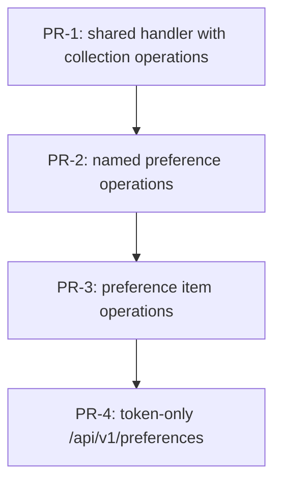

# PR plan: move customer preferences to /api/v1/preferences

Plan: `docs/jstack/preferences-api-v2/implementation-plan.md`
Budget: 500 changed lines per PR, tests included

## Stack overview

| ID | Title | Depends on | Changes | Est. LOC | Kind |
|---|---|---|---|---|---|
| PR-1 | refactor(preferences): move the collection handlers into a shared PreferenceRequestHandler | - | C-1, C-2, C-3, C-4, C-5, C-6, C-11, C-12, C-13 | 420 | logic |
| PR-2 | refactor(preferences): delegate the named preference handlers to PreferenceRequestHandler | PR-1 | C-7, C-8, C-14, C-15 | 120 | logic |
| PR-3 | refactor(preferences): delegate the preference item handlers to PreferenceRequestHandler | PR-2 | C-9, C-10, C-16, C-17 | 130 | logic |
| PR-4 | feat(preferences): serve preferences from the access token at /api/v1/preferences | PR-3 | C-18, C-19, C-20, C-21, C-22, C-23, C-24, C-25 | 430 | wiring |

Estimate basis: calibrated against the repo. The six old handlers in `CustomerController.java:1246-1438` run 30 to 35 lines each (`savePreferences` 30, `retrievePreferences` 33, `appendToPreferenceList` 35). A moved operation in the handler is counted at 30 lines (signature, id resolve, try, `authorize` call, body, two catch blocks), and each old handler reduced to one delegation is counted at 30 changed lines (about 28 body lines deleted, 2 added). A test case in `CustomerControllerPreferencesTest.java` runs 10 to 14 lines, counted at 11 for handler unit cases and 12 for the new controller's parity cases, which call both controllers. Each new Java file adds 25 lines of header, imports and class declaration. PR-1: `PreferenceAccess` 25 + 15 = 40, handler header 25, `resolveCustomerId` 10, `authorize` 25, 2 operations 60, 2 delegations 60, field and TODO 5, test support 1 line, `PreferenceRequestHandlerTest` 25 header + 15 fixtures + 13 cases x 11 = 183, total 409, rounded to 420. PR-2: 2 operations 60 + 2 delegations 60 = 120, no new test lines. PR-3: 2 operations at 35 (the longer item bodies) 70 + 2 delegations 60 = 130, no new test lines. PR-4: `PreferencesController` 25 header + 6 delegating endpoints x 8 = 73, interceptor pattern 2, config test 2, `PreferencesControllerTest` 25 header + 25 fixtures and helpers + 24 cases x 12 = 338, total 415, rounded to 430.

## Dependency graph

## PRs

### PR-1: refactor(preferences): move the collection handlers into a shared PreferenceRequestHandler

**Goal.** Add the `PreferenceAccess` enum and the `PreferenceRequestHandler` component with the guard and the two collection operations, and make old `savePreferences` and `retrievePreferences` delegate to it with no behaviour change.

**Changes.** C-1, C-2, C-3, C-4, C-5, C-6, C-11, C-12, C-13

**Files.**
- `src/main/java/com/pass/acme/controller/PreferenceAccess.java`
- `src/main/java/com/pass/acme/controller/PreferenceRequestHandler.java`
- `src/main/java/com/pass/acme/controller/CustomerController.java`
- `src/test/java/com/pass/acme/controller/PreferenceRequestHandlerTest.java`
- `src/test/java/com/pass/acme/controller/CustomerControllerTestSupport.java`

**Tests.**
- `src/test/java/com/pass/acme/controller/PreferenceRequestHandlerTest.java` asserts `statusFor` maps only `SESSION_CUSTOMER` plus `UnauthorizedException` to 401 and every other pair to 400 (C-1), that `resolveCustomerId` uses the path id in old modes, the session id in the new mode and null with no session (C-3), and that `authorize` refuses a missing session, a blank id and an `ADMIN` session in any case without calling `getCustomerById`, throws `BadRequestException("No customer for this id")` for an unknown customer, and keeps the old two orders and admin pass-through (C-4)
- `src/test/java/com/pass/acme/controller/CustomerControllerTestSupport.java` gains one `set("preferenceRequestHandler", new PreferenceRequestHandler(customerService, customerExternalDataService))` line (C-2)
- `src/test/java/com/pass/acme/controller/CustomerControllerPreferencesTest.java` is untouched, and its `SavePreferences` and `RetrievePreferences` groups (`accessRules`, own-session, admin `noExternalData_isAnEmptySuccess`, `storedPreferences_areReturned`, `unexpectedFailure_becomesAnAppException`) now run through the real handler and cover the moved lines of C-5 and C-6 (C-11, C-12, C-13). The C-5 and C-6 parity rows in `PreferencesControllerTest` land in PR-4 with the endpoints that reach the `SESSION_CUSTOMER` path.

**Verify.** `./gradlew check --no-daemon && git diff --exit-code jstack/preferences-api-v2/plan -- src/test/java/com/pass/acme/controller/CustomerControllerPreferencesTest.java`

**Review focus.** `authorize` per `PreferenceAccess` value against the data-shapes table, and that the two moved bodies keep every message, log text and catch block verbatim, with only the status taken from `access.statusFor(e)`.

**Observable.** Nothing for clients. The old collection endpoints answer exactly as before, and their log lines now come from the `PreferenceRequestHandler` logger category.

**Rollback.** Revert the merge commit. The two old handler bodies come back whole and the unused enum and handler go with it. No data or config is written.

### PR-2: refactor(preferences): delegate the named preference handlers to PreferenceRequestHandler

**Goal.** Move the POST/PUT and PATCH `{preference-name}` operations into the handler and make old `createNewPreference` and `saveLikedPreference` delegate with their existing guard orders.

**Changes.** C-7, C-8, C-14, C-15

**Files.**
- `src/main/java/com/pass/acme/controller/PreferenceRequestHandler.java`
- `src/main/java/com/pass/acme/controller/CustomerController.java`

**Tests.**
- `src/test/java/com/pass/acme/controller/CustomerControllerPreferencesTest.java` is untouched, and its `CreateNewPreference` group (`noSession_isUnauthorizedBeforeTheCustomerIsLookedUp`, `someoneElsesSession_isUnauthorized`, `unknownCustomer_isBadRequest` and the rest) and `SaveLikedPreference` group cover the moved lines of C-7 and C-8 and prove the session-first and customer-first orders are kept (C-14, C-15). The C-7 and C-8 parity rows in `PreferencesControllerTest` land in PR-4.

**Verify.** `./gradlew check --no-daemon && git diff --exit-code jstack/preferences-api-v2/plan -- src/test/java/com/pass/acme/controller/CustomerControllerPreferencesTest.java`

**Review focus.** Old `createNewPreference` passes `SESSION_THEN_CUSTOMER`, not the default mode, and the moved bodies keep `replace = true` for POST/PUT and `requestData.getOrDefault("data", new ArrayList<>())` with `replace = false` for PATCH.

**Observable.** Nothing for clients. The old named-preference endpoints answer exactly as before.

**Rollback.** Revert the merge commit. The two old handler bodies come back whole and PR-1 stays valid.

### PR-3: refactor(preferences): delegate the preference item handlers to PreferenceRequestHandler

**Goal.** Move the POST and DELETE `{preference-id}` operations into the handler and make old `appendToPreferenceList` and `removeLikedPreference` delegate with `CUSTOMER_THEN_SESSION`.

**Changes.** C-9, C-10, C-16, C-17

**Files.**
- `src/main/java/com/pass/acme/controller/PreferenceRequestHandler.java`
- `src/main/java/com/pass/acme/controller/CustomerController.java`

**Tests.**
- `src/test/java/com/pass/acme/controller/CustomerControllerPreferencesTest.java` is untouched, and its `AppendAndRemovePreferenceItem` group (`append_accessRules`, `append_ownSession_addsTheSingleItem` and the remove cases) covers the moved lines of C-9 and C-10, including the service `NON_EXIST_ERROR` surfacing as 400 (C-16, C-17). The C-9 and C-10 parity rows in `PreferencesControllerTest` land in PR-4.

**Verify.** `./gradlew check --no-daemon && git diff --exit-code jstack/preferences-api-v2/plan -- src/test/java/com/pass/acme/controller/CustomerControllerPreferencesTest.java`

**Review focus.** The four-argument log lines with `preferenceId` are copied verbatim, and append still sends `Collections.singletonList(preferenceId)` with `replace = false`.

**Observable.** Nothing for clients. All six old preference endpoints now run through one handler and answer exactly as before.

**Rollback.** Revert the merge commit. The two old handler bodies come back whole and PR-1 and PR-2 stay valid.

### PR-4: feat(preferences): serve preferences from the access token at /api/v1/preferences

**Goal.** Add `PreferencesController` with the six token-only endpoints in `SESSION_CUSTOMER` mode and register `/api/v1/preferences/**` with the header interceptor so the new API receives a `CustomerSession`.

**Changes.** C-18, C-19, C-20, C-21, C-22, C-23, C-24, C-25

**Files.**
- `src/main/java/com/pass/acme/controller/PreferencesController.java`
- `src/main/java/com/pass/acme/config/WebMvcConfig.java`
- `src/test/java/com/pass/acme/controller/PreferencesControllerTest.java`
- `src/test/java/com/pass/acme/config/WebAndSecurityConfigTest.java`

**Tests.**
- `src/test/java/com/pass/acme/controller/PreferencesControllerTest.java` extends `CustomerControllerTestSupport`, builds `new PreferencesController(new PreferenceRequestHandler(customerService, customerExternalDataService))` beside the old controller (C-18), and runs the 24 parity cases of the test plan: `SavePreferences`, `RetrievePreferences`, `CreateNewPreference`, `SaveLikedPreference`, `AppendToPreferenceList` and `RemoveLikedPreference` groups (C-5 to C-10 via C-19 to C-24) asserting each own-session result equals the old endpoint's for the same customer, refused sessions give 401 `AUTHORIZATION_ERROR` `no_permission` with storage untouched, an unknown customer gives 400, and nothing to remove gives 400 with the service message
- `src/test/java/com/pass/acme/config/WebAndSecurityConfigTest.java` `headerInterceptorGuardsCustomerAndAdminRoutesExceptThePublicOnes` gains `/api/v1/preferences` and `/api/v1/preferences/favouriteRestaurants/r1` as matched paths (C-25)

**Verify.** `./gradlew test --tests 'com.pass.acme.controller.PreferencesControllerTest' --tests 'com.pass.acme.config.WebAndSecurityConfigTest' && ./gradlew check --no-daemon`

**Review focus.** Every endpoint passes `null` and `SESSION_CUSTOMER`, the mappings match the requirement table (POST and PUT on `/{preference-name}`, no GET on it), and the interceptor pattern covers both the bare and the nested path.

**Observable.** Signed-in clients can call `GET`/`POST /api/v1/preferences`, `POST`/`PUT`/`PATCH /api/v1/preferences/{preference-name}` and `POST`/`DELETE /api/v1/preferences/{preference-name}/{preference-id}` with only a bearer token. Admin-token and missing-session calls answer 401 `no_permission`.

**Rollback.** Revert the merge commit. The new API disappears entirely and the old endpoints, already delegating since PR-3, keep working unchanged.

## Sequencing rationale

PR-1 models the domain first: the `PreferenceAccess` enum and the handler land with their own unit tests, and moving the two collection operations gives the handler a real caller whose output the untouched `CustomerControllerPreferencesTest` checks, so the refactor is proved before anything new is exposed (principles 1 and 5). PR-2 and PR-3 move the remaining operations in two small reviewable steps along the plan's grouping by URL shape. Each is checked by the same byte-identical old test file, which also covers the moved lines for the 0.98 jacoco floor. They are chained, not parallel, because both edit the same two files. PR-4 is the only change that opens a request path: the new controller, its parity tests against the old endpoints, and the interceptor pattern ship together, so reverting it alone removes the new API (principles 1 and 4).
