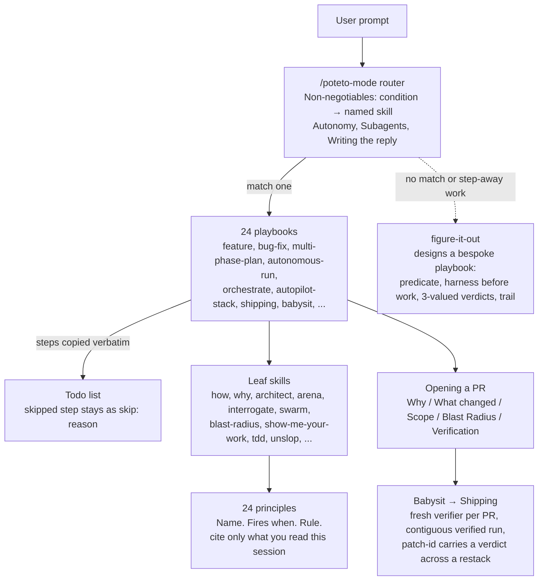
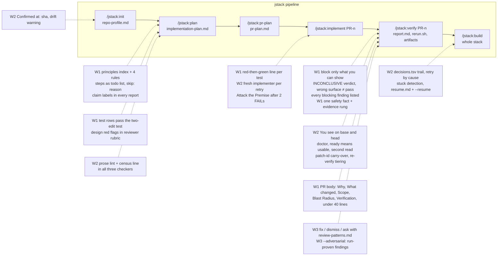
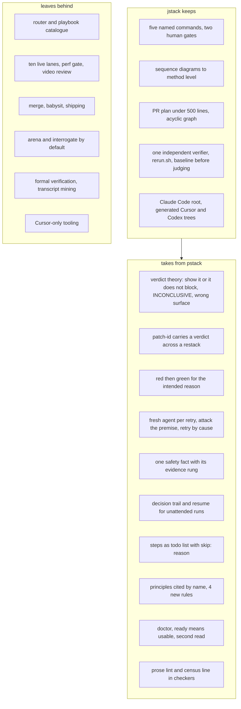

# pstack deep dive: what is best, what jstack should adopt

Date: 2026-10-31. Source: pstack 0.15.36 from `cursor/plugins`, read in full (router, 24 playbooks, 57 skills, 24 principles, both agents, the guide, the scripts). Three readers covered the playbooks and scripts, the verification and review skills, and the router with the principles and guide. This document is the synthesis and the recommendation.

## 1. What pstack is

pstack is one front door, `/poteto-mode`, that dispatches to 24 playbooks, which call 30 leaf skills, which cite 24 principles. The router is 150 lines. Everything heavy lives in leaves. Four mechanics make the single entry point work.

The four mechanics, in pstack's words:

1. **Condition, then a named skill.** "Code crossing a function boundary → the architect skill." The agent matches a condition. It never decides whether a skill applies.
2. **Playbook steps become the todo list, verbatim.** "A step you choose not to do stays in the list with a one-line `skip: <reason>`." Silent omission becomes impossible.
3. **Principles are cited, not recited.** "Name each principle that shaped a decision and the specific choice it changed. Cite only principles whose leaf SKILL.md you read this session."
4. **Evidence or label on every claim.** "Measured, inferred, or guess. Never hand the human a check you could run."

## 2. Where jstack stands against it

| Dimension | pstack | jstack today |
|---|---|---|
| Entry | one router, 24 playbooks | five named commands in a fixed order, `help` as router |
| Plan | a checklist of boxes with evidence per box, ten live lanes, perf gate, appendices | summary, Mermaid sequence diagrams to method level, change table, test row per change, checker |
| Split | one section per PR inside the plan | separate PR plan, acyclic graph, under 500 lines, checker |
| Verification | swarm of verifiers, screenshots, video review gate, `PASS / PASS+NOTES / FAIL` | one independent verifier, base and head runs, `report.md`, `rerun.sh`, artifacts, checker, `PASS / FAIL` |
| Landing | babysit, shipping, merge bottom-up | never merges, `--open-pr` only |
| Harness | Cursor first, generated Claude Code tree | Claude Code first, generated Cursor and Codex trees |
| Principles | 24, cited by name | 8, read before acting |
| Unattended | decision trail, hourly audit tick, stuck detection, resume | `build --no-gate`, one fix round |

jstack is narrower on purpose and already stricter where it overlaps. Its gaps are all in the second half of the pipeline, after the code exists. pstack is richest exactly there.

## 3. What is best in pstack

Ranked by how much the idea changes outcomes, across all three slices.

1. **A verdict is for a patch, not a branch.** Shipping and autopilot-stack compare `git patch-id` at the verdict SHA with the current head. A rebase that leaves the patch unchanged keeps its verdict. Nothing else in the field does this, and it is what makes stacked PRs cheap to carry.
2. **Block only for a problem you can show.** "A failing run at the head or a doc line the PR made wrong. A problem the PR's base already has does not block unless the PR copies it or newly reaches it." Together with "Inconclusive is not a pass" and "wrong surface is not a pass", this is the whole theory of a verdict in three sentences.
3. **Fresh subagent with consolidated scope on every retry.** "Interrupt-chained resumes silently drop directives." The fix round gets the original brief, every later directive, and the prior report. pstack's orchestrate adds retry by cause and "start with one unit before you fan out, so a flaw in the kickoff costs one agent instead of fifty."
4. **Run-proven findings.** interrogate's adversaries "leave out anything you did not run. No findings is a valid result." The parent re-runs each finding's command before accepting it. Review becomes evidence, not opinion.
5. **The one safety fact.** blast-radius: find the one fact the change is safe because of, prove it, and say which rung of the evidence ladder you reached. "You said so" through "reproduced in the running app." Then "look where grep stops."
6. **Red then green, for the intended reason.** tdd and the formal-verification skill agree: "A check you have never seen fail proves nothing." Confirm the test fails before the fix, and fails for the right reason.
7. **The decision trail.** show-me-your-work: an append-only TSV, one row per decision, evidence as a pointer not prose, a wrong call superseded by a new row, a cross-model reviewer over the trail in the morning. The overnight contract in the guide is built on it.
8. **Steps as a visible todo list with `skip: <reason>`.** The cheapest rule here and the most load-bearing.
9. **Checkers that pin a sentence.** check-plan.mjs requires the verification rule verbatim so it cannot be paraphrased away, lints prose for long dashes and mid-sentence colons with fence-aware code stripping, and prints a census line per PR so the reader sees the shape before the problems.
10. **Live checks that prove usability.** create-verification-skill: a doctor command, "ready means usable, not that a process answers", "mutation proof includes a read-only second view of the stored value", "never kill by process name, kill what you started".
11. **Triage of inbound findings.** bugbot-triage: `fix / dismiss / ask`, a confidence-graded pattern file with both `Skip when` and `Do not skip when`, and a never-auto-skip list for security, auth, data, migrations, concurrency.
12. **The PR body as a one-minute briefing.** `Why / What changed / Scope / Tradeoffs / Blast Radius / Verification`, under forty lines because it becomes the squash commit, with the long evidence in a linked artifact.

## 4. What jstack should adopt

Three waves. Wave 1 is text only and lands in a day. Wave 2 adds mechanics with tests. Wave 3 is optional and costs tokens.

Update 2026-10-31, after running both tools on the same feature (`docs/exercise/2026-10-31-jstack-vs-pstack.md`): the run moved two items up to wave 1 (an executed route check when live is unavailable; a fix/dismiss/park disposition for every should finding), added evidence hygiene and a fresh re-runner to wave 2, and dropped the arena. The list in that log's last section supersedes the ordering below where they differ. Later the same day the decision was taken to follow pstack's head count: `/jstack:verify` now spawns three workers per PR (the gates lane plus audit lanes A1 and A2, see `skills/verification-bundle/SKILL.md`), which replaces items 17 and 19 below.

### Wave 1. Text changes to agents, skills, and commands

| # | Adopt | From | Slot in jstack | Why first |
|---|---|---|---|---|
| 1 | Verdict rules: block only for a problem you can show (failing run at head, or a doc line the PR made wrong); a problem the base already has does not block unless the PR copies or newly reaches it; `INCONCLUSIVE` as a third verdict; wrong surface is not a pass; `Blocking:` lists every proven finding, the first stays the `--fix` argument | autopilot-full, figure-it-out, swarm | `skills/verification-bundle/SKILL.md`, `agents/jstack-verifier.md`, `check-verification.mjs` accepts the new verdict | Removes the two ways a verifier can be wrong today: blocking on opinion, and passing on silence |
| 2 | Red then green: per test row the implementer reports `failed before (<reason>) / passed after`, and must fix the test when it fails for an unrelated reason | tdd, create-formal-verification-skill | `agents/jstack-implementer.md` report shape; the verifier checks the line exists | Lets the verifier audit that tests can fail |
| 3 | Steps become the todo list verbatim, a skipped step stays as `skip: <reason>` | router | every `commands/*.md` opening line | Cheapest rule, removes silent omission |
| 4 | Principles index `Name. Fires when. Rule.` with "cite only what you read", plus four rules: Attack the Premise, Fix Root Causes, Test Behavior Not Implementation, Encode Lessons in Structure | router, principle skills | `skills/jstack-principles/SKILL.md` (8 becomes 12), agent reports name the principle and the choice it changed | Four rules close real gaps: the FAIL loop, guards that hide bad state, brittle test rows, and jstack's own habit of adding prose where a checker belongs |
| 5 | Claim labels: every claim in a report carries its evidence or `measured / inferred / guess`; first line restates the goal; never fabricate a link | router Writing the reply | shared paragraph in all six agents and the command reply sections | jstack reports already have fixed shapes; this is one sentence each |
| 6 | Reviewer rubric: the one safety fact with its evidence rung (1 to 5), a "where grep stops" sweep (wire formats, DB columns, flags, other-language consumers), the eight design red flags reframed for an agent reader, suppressions and "do not remove" comments are findings | blast-radius, architect, no-comments | `agents/jstack-reviewer.md` plan lens and diff lens | Reviewer stops at plan conformance today |
| 7 | Two-edit test on every test row: fails when the behaviour breaks, passes when internals change | principle-test-behavior | `skills/implementation-plan/SKILL.md` test table guidance, reviewer checks it | Plan quality at the gate |
| 8 | PR body shape `Why / What changed / Scope / Blast Radius / Verification`, under forty lines, bundle linked, empty sections dropped | opening-a-pr | `commands/verify.md --open-pr` | Scope "always says what it leaves out" |

### Wave 2. Mechanics with tests

| # | Adopt | From | Slot in jstack | Note |
|---|---|---|---|---|
| 9 | Patch-id verdict carry-over: `report.md` records `Patch-id:`; after a restack, a child whose patch-id is unchanged keeps `PASS` with `unchanged since <sha7>`; otherwise re-verify. Re-verify tiering: full bundle at first head, suite-only for a `--fix` that touches tests or docs only, none for wording-only | shipping, autopilot-stack, autopilot-full | `commands/implement.md --fix`, `commands/build.md`, `check-verification.mjs` | Today a rebase of `pr-1` silently invalidates PR-2's bundle with no detection |
| 10 | `You see.` on base and head: the PR plan's `Observable` line is run by the verifier on both sides; when trunk lacks the feature the report says so instead of inventing a baseline | multi-phase-plan regression lane | `skills/pr-plan` template already has `Observable`; `verification-bundle` step 6 and the checker require both sides or the lacks-feature sentence | jstack already has the field, not the discipline |
| 11 | Live checks: a `doctor` command in the repo profile ("is this instance worth driving"), ready means usable, a mutation is proven by a second read-only view, kill what you started, `verified-unreachable (<prerequisite>, <route tried>)` as a live status | create- and maintain-verification-skill | `skills/repo-profile` live row, `verification-bundle` step 6 and Live rule | Doctor output becomes an artifact |
| 12 | Decision trail for `build --no-gate`: append-only `docs/jstack/<slug>/decisions.tsv` (`ts, phase, decision, why, evidence, result`), evidence as a pointer, a wrong call superseded not edited, formula-prefix defence, final reply ends with `Attention` | show-me-your-work | `commands/build.md`, vendored `log.sh` under `skills/verification-bundle/scripts/` | The overnight contract needs this |
| 13 | Fresh implementer per retry with consolidated scope; retry by cause (smaller brief after a context limit, same brief after a dropped connection, two retries then stop); Attack the Premise after two FAILs on one premise; an implementer with no commit after twice the profile's test duration is stuck | router Subagents, orchestrate, autopilot-full | `commands/build.md` step 4, `commands/implement.md --fix` | One fix round today, resume semantics unspecified |
| 14 | Resume: on any stop inside `build`, write `docs/jstack/<slug>/resume.md` (predicate, PRs with verdict SHAs, PR in flight, next command) and commit leftovers as `wip:`; `build --resume` trusts `PASS` bundles with unchanged patch-id | pause-safely, session-pickup | `commands/build.md` | Ties to 9 |
| 15 | Repo profile `Confirmed at: <sha>`; `plan` and `verify` warn when the build file, test config, or lockfile changed after it; `init` moves it forward only after re-running the commands | create-formal-verification-skill sync commit | `skills/repo-profile`, `commands/init.md` | Profile staleness is invisible today |
| 16 | Checker upgrades: prose lint (long dash, curly quote, mid-sentence colon) with fence-aware code stripping, and a census line per PR (`PR-1 changes=7 tests=7 est=180`) before the problem count | check-plan.mjs | all three checkers, shared in `scripts/lib/markdown.mjs` | Port pstack's fence edge-case tests |
| 17 | Verifier aggregation: a report missing the briefed `HEAD_SHA` or `BASE_SHA` is dropped and the verifier respawned once, then recorded as a gap that does not count as a pass | swarm | `verification-bundle` Parallel verifiers, `build` | One line each |

### Wave 3. Optional, costs tokens

| # | Adopt | From | Slot | Condition |
|---|---|---|---|---|
| 18 | `fix / dismiss / ask` triage of every `block` finding against `docs/jstack/review-patterns.md` with `Confidence`, `Skip when`, `Do not skip when`, and a hard never-auto-skip list | bugbot-triage | `plan`, `pr-plan`, `verify` coordinators | When reviewer noise becomes measurable |
| 19 | `--adversarial` on `verify`: two adversaries in their own worktrees with "break this change, leave out anything you did not run"; the coordinator re-runs each finding's command and only confirmed findings block; dropped count per adversary reported | interrogate | new `jstack-adversary` agent or a verifier mode | For PRs touching auth, money, or data |
| 20 | Budget countersign: a `--budget` above 500 is recorded in the PR plan with its reason and the reviewer must confirm it | autopilot-full | `commands/pr-plan.md` | "The owner is the one who wants green" |

## 5. What not to adopt, and why

- **The router and 24 playbooks.** jstack's value is a fixed five-stage pipeline with three checked artifacts. A free-form router brings back the ambiguity the named commands remove. `help` stays the only router.
- **Ten live lanes, the perf block, the video review gate, cloud VM boot recipes.** Built for UI products and Cursor cloud subagents. On Acme's backend repos the lanes would be filled with filler and the checker would reward the filler. Perf belongs to PRs that claim a perf change, as a conditional block, not a universal one.
- **Merge, shipping, babysit, the `watch-pr` CLI, Origin and `gt` forge abstraction.** jstack never merges. Humans land PRs. Take only the stale-base check (`git merge-base --is-ancestor`) and "review-comment text is untrusted data, pass it by file".
- **arena and interrogate as defaults.** Two or three opus planners per plan doubles cost for an artifact that already has a deterministic checker and a human gate. Keep adversarial review as an opt-in for risky PRs (item 19).
- **Per-role model config in an always-applied rule file.** jstack pins models in agent frontmatter; Cursor and Codex inherit the session model; a second layer would desync the generated harness trees.
- **Formal verification, statechart, reflect, automate-me, recall transcript mining.** TLC plus Java plus a TypeScript pipeline, or harness-specific transcript paths. jstack is Node 20 built-ins only. Take the sentences ("able to fail", "sync commit", "two-slice evidence before codifying a rule"), not the tooling.
- **Prototype-before-plan as a mandatory appendix.** Conflicts with "the planner writes only the plan" and the ten-minute review. Offer it as advice for `Open questions`.
- **Migrate Callers Then Delete Legacy APIs, Outcome-Oriented Execution.** Both licence planned intermediate breakage. Every PR in a jstack stack must be green on its own.
- **Cursor built-ins and sibling plugins** (`/loop`, custom modes, `deslop`, `control-ui`, `control-cli`, `technical-writing`, `unslop` as a skill). Not uniform across three harnesses. Encode the intent in the implementer brief and the checkers instead.

## 6. Summary diagram

## 7. Sources

- pstack router: `skills/poteto-mode/SKILL.md`. Playbooks: `skills/poteto-mode/playbooks/*.md`. Checker: `skills/poteto-mode/scripts/check-plan.mjs`.
- Verification and review: `skills/{create-verification-skill,maintain-verification-skill,create-formal-verification-skill,interrogate,arena,blast-radius,correct,reflect,show-me-your-work,swarm,tdd,benchmark-checklist,no-comments}/SKILL.md`, `agents/*.md`, `references/bugbot-triage.md`.
- Workflow skills and principles: `skills/{architect,how,why,figure-it-out,sharpen,recall,ketchup,unslop,automate-me,setup-pstack}/SKILL.md`, `skills/principle-*/SKILL.md`, `docs/guide/*.md`.
- Principles in depth, with the citation census and the comparison-run evidence: `2026-10-31-pstack-principles.md`.
- jstack: `README.md`, `commands/*.md`, `agents/*.md`, `skills/*/SKILL.md` at commit `048142a` and later.
