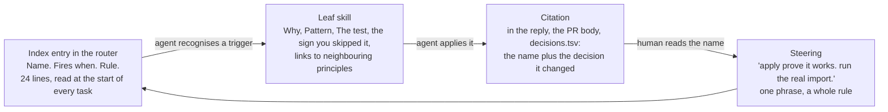
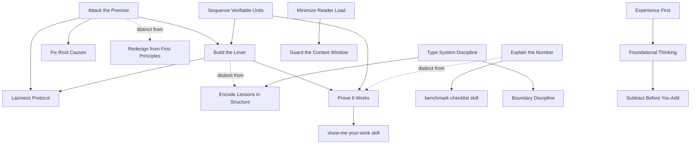

# pstack principles, in depth

Date: 2026-10-31. Source: pstack 0.15.36, read in full: the Principles index in `skills/poteto-mode/SKILL.md`, guide page `docs/guide/08-principles.md`, all 24 `skills/principle-*/SKILL.md` leaves, every file that cites a principle (router, `poteto-agent.md`, `poteto-help`, `no-comments`, five playbooks, two guide pages), and the committed artifacts of the two comparison runs in `docs/exercise/2026-10-31-jstack-vs-pstack.md`, grepped for citations. Companion to `2026-10-31-pstack-deep-dive.md`, which covered the pipeline. This document covers only the principles: how the mechanism works, what each of the 24 says, what the runs show, and what jstack should take.

## 1. How a principle works in pstack

A pstack principle is three things stacked, and the stack is the design.

**The index is the rule, the leaf is the depth.** The router carries one line per principle in the form `Name. Fires when. Rule.` and says "Read the leaf skill in full for any principle you apply." Leaves carry `disable-model-invocation: true`, so the harness never loads one on its own. The agent reads the index, matches a trigger, and chooses to open the leaf. A human can still type `/principle-<name>` to load one on demand.

**Citation is the proof of application.** Three sentences carry the whole discipline:

- "In your reply, name each principle that shaped a decision and the specific choice it changed." (router)
- "Cite only principles whose leaf SKILL.md you read this session." (router)
- "A principle citation with no decision behind it means the agent named the rule without applying it." (guide)

Build the Lever goes one step further and makes the citation falsifiable: "Applying this principle produces a file. If you cited it and there is no codemod, script, generator, or delegate skill in the diff, you didn't apply it."

**Self-diagnosis lines.** Several leaves end with the sign that the agent skipped the principle, written so a reviewer can spot it after the fact in a diff: "a new feature that grows an existing if/else chain by one more branch, or a second boolean that must stay in sync with the first" (Model the Domain); "You skipped this when a run started without the result that would change a decision" (Explain the Number); "If a workaround needs a paragraph-long comment to justify it, the code is wrong" (Fix Root Causes). This is the most reusable idea in the set, because it turns a value into something an audit lane can check.

**Tests, not slogans.** The strong leaves end with a question the agent answers about the code in front of it. "Is this data crossing a system boundary right now?" (Boundary Discipline). "What happens if this runs twice? If the previous run crashed at every possible point?" (Idempotent). "Can a new reader answer where X comes from and what can change X in under 30 seconds?" (Reader Load). "Break the behaviour; does the test still pass? Change the internals; does it fail?" (Test Behaviour).

**Steering by name.** The guide tells the human not to invoke principles but to use the names: "use subtract before you add. delete the obsolete adapters first." A name points at a rule the agent has already read, so one phrase redirects more precisely than a paragraph.

### Where the weight is

The leaves are uneven, and that is deliberate. The index line is the rule; a leaf only exists to add a why, a pattern, and a test when the rule needs them.

| Leaf length | Principles |
|---|---|
| 1 to 4 sentences (index line carries it) | Exhaust the Design Space, Encode Lessons in Structure, Laziness Protocol, Guard the Context Window, Redesign from First Principles, Migrate Callers |
| Pattern plus a test | Attack the Premise, Boundary Discipline, Build the Lever, Fix Root Causes, Idempotent, Reader Load, Model the Domain, Separate Before Serializing, Test Behaviour, Type System Discipline, Explain the Number |
| Lists of applications | Experience First, Foundational Thinking, Never Block, Outcome-Oriented, Prove It Works, Sequence Verifiable Units, Subtract Before You Add |

### Which principles pstack actually wires in

A census of pstack's own files, counting the files outside the leaf that name each principle:

| Files citing it | Principle | Wired into |
|---|---|---|
| 8 | Prove It Works | session-pickup, refactoring, worktree-cleanup, no-comments context, guide 06, help, router, agent |
| 6 | Guard the Context Window | trace-forensics, worktree-cleanup, Reader Load leaf, router, guide |
| 5 | Model the Domain | feature step 4 (data shape in every delegate brief), refactoring step 2, router non-negotiable "Any code" |
| 5 | Laziness Protocol, Build the Lever, Redesign from First Principles | refactoring, worktree-cleanup, no-comments, Attack the Premise leaf |
| 4 | Fix Root Causes, Encode Lessons in Structure | no-comments step 4, correct skill, Type System leaf |
| 3 | Sequence Verifiable Units, Subtract Before You Add, Reader Load, Migrate Callers, Foundational Thinking, Explain the Number | feature step 4, refactoring steps 3 to 8, benchmark-checklist |
| 2 | the other nine | router index and guide page only |

Nine of the 24 (Experience First, Exhaust the Design Space, Outcome-Oriented Execution, Idempotent, Separate Before Serializing, Boundary Discipline, Type System Discipline, Attack the Premise, Never Block on the Human) appear nowhere except the index and the guide. They are vocabulary for the human to steer with, not steps any playbook executes. The ones that change outcomes are the ones a playbook step names. That is the lesson for jstack in section 5: a principle that no command step cites is a hope.

### How the principles refer to each other

Three hubs: Prove It Works (what counts as evidence), Build the Lever (how to make evidence cheap and rerunnable), and Laziness Protocol (how small the change should be). Everything else hangs off those.

## 2. The 24, one by one

Each entry: when it fires, the rule, the test or the sign you skipped it, and where jstack stands. "Have" means jstack states it. "Practises" means jstack does it by construction without naming it. "Missing" means neither.

### Core: how much to build and when to rethink

**Laziness Protocol.** Fires when refactoring, sizing a diff, or tempted to add a layer. Rule: consolidate each decision behind one source of truth and pass the result as a flag; make the smallest change that solves the problem, fewer lines beat elegant boilerplate. The whole leaf is two bullets. jstack: partial. Principle 4 (small diffs) is a budget, 500 lines, not a bias. The bias to deletion is absent from the planner and implementer.

**Foundational Thinking.** Fires before writing logic. Rule: data structures first, trace every access pattern; DRY the structure not every line, three similar statements beat a premature abstraction; scaffold first when every later phase benefits (CI, lint, test infra, shared types); subtraction before scaffolding; each increment lands or deepens one coherent abstraction, never special-case coordination spread across callers. Concurrency corollary: before sharing state, ask what happens if another actor modifies it, and if the answer is not "nothing", isolate. jstack: partial. The plan's `Data shapes` section is data first. Scaffold sequencing and the concurrency question are not in the planner.

**Redesign from First Principles.** Fires when integrating a new requirement into an existing design. Rule: ask what you would build if the requirement had been there from day one, propagate through types, docs, examples, rationale; think the whole redesign, deliver it incrementally. jstack: missing. The planner is told to read the code, not to ask this question. The comparison run showed the effect: pstack's plan replaced six guard copies with a sealed union; jstack's bolted an enum onto the same handler shape.

**Attack the Premise.** Fires when two or more fixes that share one premise have failed the same gate. Rule: write the premise as one sentence, find an observation that would differ if it were false, make it, and only then fix. Look at how failures are distributed, not how large. Remove the condition rather than compensate for it. Stop line: "Do not start the next fix before the premise is written down and tested." jstack: missing, and this is the FAIL loop's blind spot. `build` runs one fix round; nothing asks whether the second attempt shares the first attempt's assumption.

**Subtract Before You Add.** Fires when sequencing an addition, refactor, or rewrite. Rule: remove dead code, redundant validators, and stub references first; cut before you polish; design for observed usage, no speculative guards beyond what the spec demands; a reference with no novel content is deleted, not stubbed. jstack: missing. The PR plan orders PRs by dependency, never "subtraction first."

**Minimize Reader Load.** Fires when reviewing or shaping code that is hard to trace. Rule: track two independent axes, layers to trace and state to hold; collapse one-caller wrappers and pass-through layers; demand that each layer change the abstraction; shrink state scope (returns over mutations, locals over fields, fields over module state); name the invariant at the boundary once. Test: can a new reader answer "where does X come from" and "what can change X" in under 30 seconds. jstack: partial. Principle 6 protects the plan's reader (ten minutes). Nothing protects the code's reader. This belongs in the A2 audit lane.

**Outcome-Oriented Execution.** Fires during planned rewrites with explicit phase boundaries. Rule: converge on the target architecture, accept planned, scoped, reversible intermediate breakage, verify fully at plan completion. jstack: not taking, decided in the deep dive. Every PR in a jstack stack is green on its own.

**Experience First.** Fires on product, UX, or scope tradeoffs. Rule: delight over convenience, fewer polished features over more rough ones, prototype in throwaway HTML before production code, tighten the core loop. The useful sentence for a backend tool: "The user is whoever consumes the work. For a library or an internal API it is the colleague who imports it. The engineer who maintains the code next is a user too." jstack: missing as a rule. Take only that sentence, into the reviewer's view of an API change.

**Exhaust the Design Space.** Fires on a novel interaction or architectural decision with no precedent. Rule: build two or three competing prototypes and compare side by side. The leaf is one sentence; the mechanism is the `arena` skill. jstack: not taking. The comparison run dropped the arena: two opus candidates and a judge cost 952 lines for a choice the planner could have made.

**Build the Lever.** Fires on any non-trivial work, not only bulk work. Rule: build the codemod, script, generator, or delegate skill that does or proves the work; do the first unit by hand to learn the recipe, then build the tool and diff it against the hand version; a deterministic lever beats fan-out; when you do fan out, the lever is a skill every delegate reads, kept outside their write scope; commit the lever when the work outlives the session. The bar is triviality, not repetition. jstack: practises. `rerun.sh`, `pr-size.sh`, three checkers, and the harness generator are levers. The implementer has no instruction to build one for a sweep, and the citation rule "produces a file" is absent.

### Architecture: where state, validation, and compatibility live

**Model the Domain.** Fires when writing stateful logic or code that branches a lot or repeats a shape assumption across files. Rule: a state machine over scattered booleans, a typed model over loose parameters, a table or registry or discriminated union over branching across files, a reducer over ad hoc mutation, a module around one body of domain knowledge over load-validate-transform-save phases. Do not force it; boring code stays when the shape is clear and local. Sign you skipped it: a feature that grows an if/else chain by one branch, a second boolean that must stay in sync with the first, phase-named modules. jstack: have (principle 5), and it is the only principle the jstack run applied visibly ("Model the guard as data first").

**Boundary Discipline.** Fires when wiring validation, error handling, or framework adapters. Rule: validate, narrow, and handle errors at CLI, config, network, and external API boundaries; trust internal types unconditionally; business logic in pure functions the shell calls; expose domain concepts, never re-export transport or storage types through the public surface. Tests: "Is this data crossing a system boundary right now? If not, validation is redundant." and "Can this be a pure function that the shell just calls?" jstack: missing. On a Spring repo this is the most frequently relevant rule in the set, and the A2 lane has no sentence for it.

**Type System Discipline.** Fires when designing types or reviewing a signature. Rule: make illegal states unrepresentable; brand semantic primitives (two arguments of the same primitive type that mean different things get their own types); external data is untyped until parsed, one parse function per boundary; exhaust variants; derive types from the authoritative schema (OpenAPI, protobuf, migration) instead of hand-rolling a parallel one. jstack: missing. Java 21 sealed interfaces and records make the first two cheap, as pstack's run showed.

**Make Operations Idempotent.** Fires when designing commands, lifecycle steps, or loops that run amid crashes and retries. Rule: derive each step from the state that exists, not from what the previous run meant to do; read current state, compare to goal, apply the difference; anything a run leaves behind must be recognisable as stale by the next run, judged by evidence that holds wherever the run could have stopped; write to a temporary path and rename. Test: runs twice, crashed at every point, converges. jstack: missing, and it applies to jstack itself. `build --resume` from the deep dive is an idempotency problem, and `verify` already re-runs safely only because the bundle directory is overwritten.

**Migrate Callers Then Delete Legacy APIs.** Fires when a new internal API lands while old callers exist. Rule: migrate and delete in one wave, no compatibility layers; update tests to the new contract and delete tests that protected old internals; applies when no external users depend on compatibility. jstack: not taking as a principle. The "delete tests that only protect pre-refactor internals" sentence belongs in Test Behaviour.

**Separate Before Serializing Shared State.** Fires when concurrent actors might write the same file, branch, key, or object. Rule: first ask whether they need one canonical object or are publishing independent facts; give each actor its own file, branch, or key and merge at the read boundary; serialise structurally (lockfile, sequential phase, single writer, compare-and-swap) only when one shared target is a real invariant. "Instructions and conventions are not concurrency control." "Treat we need a lock as a design smell to check." jstack: practises. `build` verifies PRs one at a time on the main checkout and the three verification workers write separate reports the coordinator merges. The rule is unstated, and the implementer never sees it for the product code it writes.

### Verification: what counts as proof

**Prove It Works.** Fires after a task, before declaring done. Rule: check the real thing, not a proxy, a self-report, a file mtime, or "it compiles"; check process liveness directly; read the actual value; when verification fails, suspect the observation method first; script the check and keep its output as an artifact a reviewer can re-run; commit the artifact only for work whose trail must be auditable later. jstack: have (principle 2), and stronger than pstack's leaf: every bundle ships `rerun.sh` and a fresh re-run matched.

**Fix Root Causes.** Fires when debugging. Rule: reproduce first; ask why until the answer is a wrong decision in the code, not a consequence of an earlier one; instrument when stuck, read the actual error and state; decide whether the triggering state is legitimate, because a guard on an illegitimate state hides the bug; after a restart suspect persisted state; fix the pattern, not the instance; a workaround that needs a paragraph of comment is wrong code; propose the always-on signal that would have shown the fact at first look. jstack: missing. The `--fix` round brief says "fix the blocking finding"; nothing says reproduce, trace, or check for the pattern.

**Sequence Work into Verifiable Units.** Fires on sweeps, migrations, runs of similar edits, and commit and PR stacking. Rule: each unit is a before/after bracket on a known-good state; rebase onto clean trunk first so every check measures the real baseline; when a lever does the edits, run the per-unit check anyway; deliver in the order that proves the work, failing test first then the fix, subtraction before reshape, scaffold before feature, so "the sequence reads as an argument." jstack: have (principle 1). jstack's principle 8 (baseline before judging) is this leaf's "rebase onto clean trunk" sentence promoted to its own rule.

**Test Behaviour, Not Implementation.** Fires when writing, changing, or keeping a test. Rule: behaviour is what a caller, user, or other service can observe: return values, errors, state read back, a request sent, a row written. Two imagined edits decide every test: break the behaviour, and if the test still passes it proves nothing (loose assertion, expected value computed by the code under test, a restated constant, an assertion on data the test built); change the internals, and if the test fails it is pinned to implementation. Keep the test that catches the first and survives the second. The contract decides the assertion's shape: a mocked external service's payload is behaviour, a call to an internal helper is not; the error type callers branch on is contract, the message is not. jstack: missing. Plan test rows require one test per change row and say what the test asserts, but no sentence applies the two-edit test. The comparison run's jstack stack added 37 tests and not one executed a route; pstack's included a MockMvc route test. This rule is the single biggest quality lever still open.

**Explain the Number.** Fires before measuring and before trusting or reporting a number. Rule: write the decision the result would change and the noise floor before the run; ask "why not double" and name the limiting resource from a profile or counters, not from reading code; list what else the number could be measuring (errors, cached work, code that never ran, an untuned side, noise) and rule each out; keep run count, spread, and limiter with the number. jstack: missing, and conditional. Take it only as a sentence in the verifier for PRs that claim a performance change.

### Delegation: keeping parallel work sane

**Guard the Context Window.** Fires when context fills: large outputs, long files, repeated reads, fan-out planning. Rule: route bulk to subagents and keep summaries in the main thread; size phases and cap scope, limit files per phase, set turn budgets. jstack: practises. The explorer agent exists for this. The commands never say why, and the coordinator in `build` has no file or turn cap. The compaction that happened during this session's own comparison run is the symptom.

**Never Block on the Human.** Fires when tempted to ask "should I do X" on reversible work. Rule: proceed, then present; log a problem and fix it next round; irreversible actions (force-push, delete production data, send external messages) still need confirmation; product direction comes from the human, execution does not block. jstack: have (principle 7), with the sharper `Open questions` mechanism and the router's "classify the question before you ask it: a fact you could observe is not the human's to answer."

### Meta

**Encode Lessons in Structure.** Fires when you write the same instruction a second time or notice a recurring correction. Rule: encode it as a lint, metadata flag, runtime check, or script; if the lesson needs judgement and cannot be encoded, make the instruction more prominent and add an example of the failure; "if the fix is structural, only use the structural fix. The instruction is the symptom." jstack: practises without saying it. Three checkers and the harness freshness test are this principle. Section 3 shows one place jstack has an instruction where it needs a check.

## 3. What the comparison run shows

Both tools were told to cite principles. Only one did.

| Run | Artifacts grepped | Distinct principles cited | Citations |
|---|---|---|---|
| pstack `ed9a36f0` | plan, design, two arena candidates, `decisions.tsv`, `todo.md` | 7 | 13 |
| jstack `pr-4` branch | implementation plan, PR plan, four bundles | 0 | 0 |

pstack's citations: Model the Domain 4, Type System Discipline 2, Reader Load 2, Boundary Discipline 2, Test Behaviour 1, Sequence Verifiable Units 1, Laziness Protocol 1. Every one sits beside the decision it changed. The clearest: "Only the three rules construct it, so holding one proves a rule ran (per `principle-model-the-domain` and `principle-type-system-discipline`)." And the `decisions.tsv` row that declined to act on Comment Sicko's duplicated-handler observation gave the reason in the design's terms rather than waving at a rule.

jstack's plan did apply Model the Domain ("Model the guard as data first") but never named it, and the implementer and verifier reports named nothing, although `skills/jstack-principles/SKILL.md` says "Name the principle that shaped a decision when you report back."

The cause is not the agents. The instruction lives in one sentence of a skill. No report shape has a `Principles` line, no template has a placeholder, and no checker looks for one. pstack's own meta principle names this exact failure: the instruction is the symptom, the fix is structural.

## 4. Map: pstack's 24 against jstack's 8

| pstack | jstack today | Status |
|---|---|---|
| Sequence Work into Verifiable Units | 1 Sequence work into verifiable units | have |
| Prove It Works | 2 Prove it works against the real artifact | have, stronger (`rerun.sh`) |
| Model the Domain | 5 Model the domain before writing logic | have |
| Never Block on the Human | 7 Never block on the human for an observable fact | have, sharper |
| Laziness Protocol | 4 Small diffs are a feature | partial: budget without the bias to deletion |
| Foundational Thinking | 5 `Data shapes` section | partial: no scaffold-first, no concurrency question |
| Minimize Reader Load | 6 Diagrams carry the detail (plan reader only) | partial |
| Guard the Context Window | explorer agent | practises, unstated |
| Build the Lever | checkers, `rerun.sh`, `pr-size.sh`, generator | practises, unstated |
| Separate Before Serializing | serial verify, per-worker reports | practises, unstated |
| Encode Lessons in Structure | three checkers, freshness test | practises, unstated |
| Test Behaviour, Not Implementation | test row per change | missing |
| Fix Root Causes | `--fix` round | missing |
| Attack the Premise | one fix round, no premise check | missing |
| Redesign from First Principles | planner reads code | missing |
| Subtract Before You Add | PR order by dependency | missing |
| Boundary Discipline | none | missing |
| Type System Discipline | none | missing |
| Make Operations Idempotent | none | missing |
| Explain the Number | none | missing, conditional |
| Experience First | none | take one sentence |
| Exhaust the Design Space | arena dropped | not taking |
| Outcome-Oriented Execution | every PR green | not taking |
| Migrate Callers Then Delete | every PR green | not taking |

jstack states two rules pstack has only as mechanism: 3 Never verify your own code (pstack's fresh verifier per PR in babysit and swarm) and 8 Baseline before judging (one sentence inside Sequence Verifiable Units). Keep both as named principles; they are jstack's clearest advantage in the verdict.

## 5. What jstack should take

Nothing below is built. It is the proposal, in the order it pays.

1. **Rewrite the index into pstack's form.** `Name. Fires when. Rule.` for every entry, grouped Core, Architecture, Verification, Delegation, Meta. Keep the eight. Add twelve: Laziness Protocol, Foundational Thinking, Redesign from First Principles, Attack the Premise, Subtract Before You Add, Minimize Reader Load, Build the Lever, Boundary Discipline, Type System Discipline, Make Operations Idempotent, Fix Root Causes, Test Behaviour Not Implementation. Add two coordinator entries read by the commands rather than the agents: Guard the Context Window and Encode Lessons in Structure. Twenty-two lines. Leaves only for the seven that carry a test (Test Behaviour, Model the Domain, Boundary, Type System, Idempotent, Reader Load, Fix Root Causes plus Attack the Premise), as `references/*.md` under the skill, with pstack's "the sign you skipped it" line kept on each.

2. **Make the citation structural.** Every agent report ends with `Principles: <name>: <decision it changed>; ...` or `Principles: none`. The plan and PR plan templates get the same line in `Summary`. `check-plan.mjs`, `check-pr-plan.mjs`, and `check-verification.mjs` verify that the line exists and every name is in the index. Two tests each. This closes the gap in section 3 with the mechanism pstack recommends for it, and it costs under a hundred lines.

3. **Wire each principle to a step, or it is vocabulary.** pstack's census says so. Proposed wiring:

   | Principle | jstack step |
   |---|---|
   | Model the Domain, Foundational Thinking, Redesign from First Principles | `implementation-plan` `Data shapes`, planner reads them before `Approach` |
   | Subtract Before You Add, Laziness Protocol | `pr-plan`: a subtraction PR is allowed to come first; splitter asks what the stack deletes |
   | Test Behaviour | `implementation-plan` test rows: each row passes the two-edit test; reviewer checks it at the plan gate |
   | Build the Lever | implementer brief: a sweep of more than five similar edits gets a script in the diff; verifier already ships `rerun.sh` |
   | Fix Root Causes, Attack the Premise | `implement --fix` and `build` fix round: reproduce first; after two FAILs that share a premise, the brief names the premise and the observation that tested it |
   | Boundary Discipline, Type System Discipline, Reader Load, Idempotent | A2 audit lane in `verify`: four questions, each a `should` finding with the file and line |
   | Separate Before Serializing | A2 lane when a PR adds a job, a retry, or a cache |
   | Experience First (one sentence) | A1 lane when a PR changes a public signature: who imports it, what they now hold |
   | Guard the Context Window | every command: explorer for bulk reads, coordinator keeps findings |
   | Encode Lessons in Structure | `docs/guide`: a correction the human has given twice becomes a checker rule, not a sentence |

4. **Let the human steer by name.** One paragraph in the guide and in `help`: writing `apply fix root causes` as the `--fix` note, or `subtract before you add` in a `plan` request, redirects the agent, and the report's `Principles` line shows whether it landed.

Everything in items 1, 3, and 4 is text in `skills/`, `agents/`, and `commands/`, then a harness regeneration. Item 2 is the only code. One day of work, and it is the part of pstack jstack is furthest from today.
