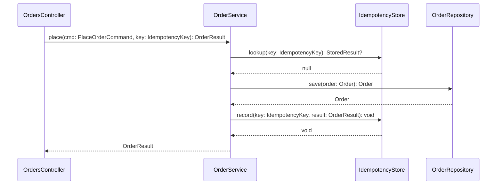
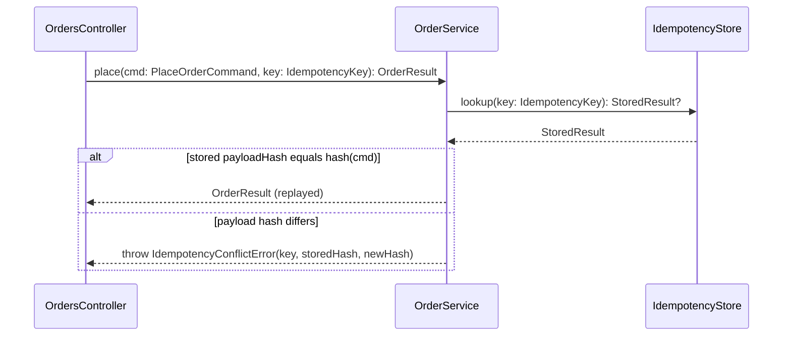

# Implementation plan: add idempotency key to OrderService.place

<!-- Worked example. The feature is fictional. File paths point at files in the jstack repo so the checker's existence check passes when this example is used in tests. -->

## Summary

Checkout clients retry `POST /orders` on timeouts and sometimes create two orders.
This plan adds an idempotency key to `OrderService.place`.
A client sends the key in the request. The service looks it up before saving.
A fresh key saves the order and records the result against the key.
A seen key with the same payload replays the stored result.
A seen key with a different payload fails with `IdempotencyConflictError`.
The smallest change is one new store class, one error type, and one branch in `place`.
No schema change to orders. Keys expire after 24 hours.

## Scope

In:

- Key lookup, replay, and conflict handling inside `OrderService.place`.
- A new `IdempotencyStore` with `lookup` and `record`.
- A new `IdempotencyConflictError` type.

Out:

- Reading the key from the HTTP header. The controller already passes it through.
- Backfilling keys for orders placed before this change.
- Cross-region replication of the key store.

Assumptions:

- Keys are client generated UUIDs (from the design).
- A 24 hour TTL is long enough for every retry window we see (planner's call).
- The payload hash is SHA-256 of the canonical JSON body (planner's call).

## Design

Source: planner's draft

Approach: Keep the orders table untouched and put idempotency in a small keyed store beside the service. `place` gains one lookup before the save and one record after it. The store holds the result and a payload hash so a replay with a changed body is rejected rather than silently returning a stale order. The branch lives in the service, not the controller, so every caller of `place` gets the same guarantee.

Alternatives rejected:

| Alternative | Why not |
|---|---|
| Unique index on `orders.idempotency_key` | Needs a migration and a backfill, and still cannot replay the original response body. |
| Middleware that caches whole HTTP responses by key | Ties the guarantee to one transport and leaves internal callers of `place` unprotected. |
| Reject every reuse of a key, no replay | Breaks the retry case the requirement exists for. |

## Grounding

Pointers:

- `scripts/lib/markdown.mjs:14` `parseDocument` stands in for `OrderService.place` in this example.
- `scripts/lib/markdown.mjs:63` `sectionBetween` stands in for the repository call the service makes.
- `scripts/lib/markdown.test.mjs:1` test layout, one file beside the module, `node:test` with strict assert.

Conventions:

- Modules are ESM with named exports. No default exports.
- Errors are plain `Error` subclasses with a stable `name` and a `code` field.
- Tests live beside the module as `<name>.test.mjs` and run with `node --test`.

Commands:

- Test: `node --test "scripts/**/*.test.mjs"`
- Lint: none in this repo.
- Build: none in this repo.

## Data shapes

- `IdempotencyKey`. A string, UUID v4, supplied by the client.
- `StoredResult`. `{ payloadHash: string, result: OrderResult, expiresAt: number }`.
- `OrderResult`. Unchanged. `{ orderId: string, status: "placed" }`.
- `IdempotencyConflictError`. `Error` with `code = "IDEMPOTENCY_CONFLICT"`, `key`, `storedHash`, `newHash`.

The organising structure is a keyed table rather than a state machine. There are only two states for a key, unseen and seen, and the payload hash decides replay or conflict.

## Sequence diagrams

### SD-1: Place an order with a fresh key

### SD-2: Replay or conflict on a seen key

## Change table

| ID | File | Class | Method | Change | Responsibility | Diagrams |
|---|---|---|---|---|---|---|
| C-1 | scripts/lib/markdown.mjs | OrderService | place(cmd: PlaceOrderCommand, key: IdempotencyKey): OrderResult | modify | Look the key up before saving, replay or conflict on a hit, record after a save. | SD-1, SD-2 |
| C-2 | scripts/lib/idempotency-store.mjs | IdempotencyStore | lookup(key: IdempotencyKey): StoredResult? | add | Return the stored result and payload hash for a key, or null when unseen or expired. | SD-1, SD-2 |
| C-3 | scripts/lib/idempotency-store.mjs | IdempotencyStore | record(key: IdempotencyKey, result: OrderResult): void | add | Persist the result with the payload hash and a 24 hour expiry. | SD-1 |
| C-4 | scripts/lib/idempotency-conflict-error.mjs | IdempotencyConflictError | - | add | Error raised when a seen key arrives with a different payload. | SD-2 |

## Test plan

### Unit tests

| Change | Test file | Cases | Asserts |
|---|---|---|---|
| C-1 | scripts/lib/order-service.test.mjs | place saves once for a fresh key, place replays the stored result for a seen key, place throws on a seen key with a new payload | One save per key. The replay returns the same orderId. The conflict never touches the repository. |
| C-2 | scripts/lib/idempotency-store.test.mjs | lookup returns null for an unseen key, lookup returns null after expiry, lookup returns the stored result | Unseen and expired keys read as null. A recorded key returns its hash and result. |
| C-3 | scripts/lib/idempotency-store.test.mjs | record stores the hash and result, record sets expiresAt 24 hours ahead | A recorded entry is readable and carries the expected expiry. |
| C-4 | scripts/lib/order-service.test.mjs | conflict error carries key and both hashes | The error has code IDEMPOTENCY_CONFLICT and exposes key, storedHash, and newHash. |

### E2E scenarios

| ID | Flow | Actor | Given | When | Then | Diagrams |
|---|---|---|---|---|---|---|
| S-1 | Fresh key places the order | checkout client with a valid session | key `k-1` unseen, repository accepts the save | `POST /orders` with `Idempotency-Key: k-1` and body B | 201 with a new `orderId`, `status: placed`; the store recorded `k-1` once with hash(B) | SD-1 |
| S-2 | Seen key with the same payload replays | checkout client | `k-1` recorded with hash(B) and result R | `POST /orders` with `k-1` and body B | 200 with body R; the repository received no save | SD-2 |
| S-3 | Seen key with a different payload conflicts | checkout client | `k-1` recorded with hash(B) | `POST /orders` with `k-1` and body B2 | 409 with `code: IDEMPOTENCY_CONFLICT`, `key: k-1`; the repository received no save | SD-2 |
| S-4 | Expired key behaves as fresh | checkout client | `k-1` recorded 25 hours ago | `POST /orders` with `k-1` and body B | 201 with a new `orderId`; the store recorded `k-1` again | SD-1 |

### Component tests

| ID | Scenarios | Test file | Harness | Stubs | Asserts |
|---|---|---|---|---|---|
| CT-1 | S-1, S-4 | scripts/lib/orders-http.component.test.mjs | supertest over `createOrdersApp()` with the production error mapper installed | `IdempotencyStore` in-memory fake with an injectable clock; `OrderRepository` stub recording `save` calls | 201 and a UUID `orderId`; `record` called once with the key and hash(B); `save` called once |
| CT-2 | S-2, S-3 | scripts/lib/orders-http.component.test.mjs | same as CT-1 | same as CT-1, store pre-loaded with `k-1` | 200 body equals R and `save` not called; 409 body carries `IDEMPOTENCY_CONFLICT` and `save` not called |

### Blackbox tests

| ID | Scenarios | Test file | Boot | Stubs | Asserts |
|---|---|---|---|---|---|
| BB-1 | S-1, S-2, S-3, S-4 | scripts/blackbox/orders.bb.test.mjs | profile `blackbox boot` row: `node scripts/orders-app.mjs` with `KEY_STORE_URL` and `ORDERS_DB` from env, ready when `GET /health` is 200 | key store stub server `scripts/blackbox/stubs/key-store.mjs` on `KEY_STORE_URL`, recording requests and serving seeded keys; orders database as a fresh SQLite file per run | statuses and bodies over real HTTP as each scenario's Then; the stub recorded one `record` for S-1 and S-4 and none for S-2 and S-3 |

## Risks and rollbacks

- A store outage makes every `place` fail (C-1). Rollback: feature flag `orders.idempotency` off skips the lookup and record calls.
- Expiry clock skew replays a stale result after 24 hours (C-2). Rollback: shorten the TTL in config, no code change.

## Open questions

- Should a replayed response carry a header that marks it as a replay? Product call.
