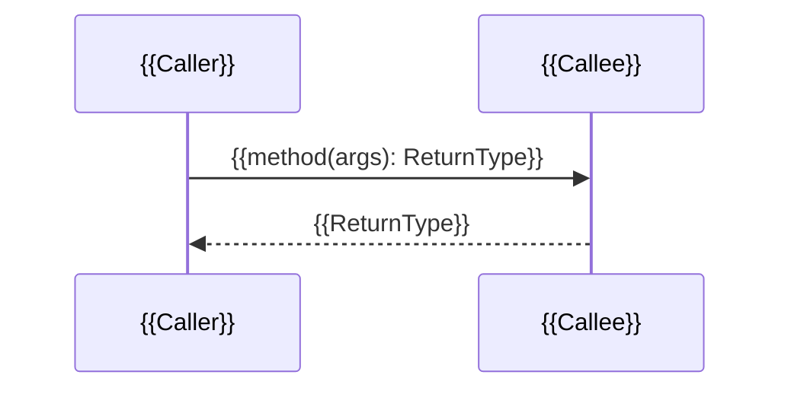

# Implementation plan: {{feature name}}

<!-- Fill every {{placeholder}}. The checker fails on any that remain. Keep headings exactly as written and in this order. -->

## Summary

<!-- At most 12 non-empty lines. Who it is for, what changes for them, and the smallest change that meets the requirement. -->

{{summary}}

## Scope

<!-- Three lists. In, out, assumptions. Mark each assumption as "from the design" or "planner's call". -->

In:

- {{in scope item}}

Out:

- {{out of scope item}}

Assumptions:

- {{assumption}} (from the design)
- {{assumption}} (planner's call)

## Design

<!-- Source is one of: "Source: given (<path>)" or "Source: planner's draft". The Approach paragraph says how the change is shaped. The table lists each alternative considered and one line on why it lost. -->

Source: {{given (path) or planner's draft}}

Approach: {{one paragraph on the approach}}

Alternatives rejected:

| Alternative | Why not |
|---|---|
| {{alternative}} | {{reason}} |

## Grounding

<!-- One pointer per touched module as path:line. Conventions found in the code (DI style, error handling, test layout). Exact test, lint, and build commands from docs/jstack/repo-profile.md. -->

Pointers:

- `{{path}}:{{line}}` {{what lives there}}

Conventions:

- {{convention}}

Commands:

- Test: `{{test command}}`
- Lint: `{{lint command}}`
- Build: `{{build command}}`

## Data shapes

<!-- New or changed types, enums, columns, payloads. Name the organising structure (state machine, table, typed model) and say why. -->

{{data shapes}}

## Sequence diagrams

<!-- One diagram per user-visible flow or error path. Participants are real class or module names. Every message is method(args): ReturnType. Use alt and loop for branches. Each diagram has an SD-n id and a one-line caption. -->

### SD-1: {{caption}}

## Change table

<!-- One row per class and method. ID is C-n. Change is add, modify, or delete. Method is name(params): Return, or - for a class or file level row. Diagrams is a comma list of SD-n ids where the method appears as a message. Files for modify and delete rows must exist. -->

| ID | File | Class | Method | Change | Responsibility | Diagrams |
|---|---|---|---|---|---|---|
| C-1 | {{path}} | {{Class}} | {{method(params): Return}} | {{add, modify, or delete}} | {{one line}} | SD-1 |

## Test plan

<!-- Four tables, in this order, each under its own H3. Read skills/test-tiers/SKILL.md for the tier definitions and the stack recipes.
     Unit: one row per change row. Scenarios: one per diagram flow, per alt branch, per requirement rule; ids S-n; every SD-n appears in at least one row.
     Component: ids CT-n, Scenarios is a comma list of S-n, Harness names the mechanism (MockMvc @WebMvcTest, Nest TestingModule + supertest), Stubs names each stubbed dependency.
     Blackbox: ids BB-n, Boot names the profile's blackbox boot row or the command, Stubs names each external system and its stub.
     Every S-n must appear in at least one CT row and at least one BB row. -->

### Unit tests

| Change | Test file | Cases | Asserts |
|---|---|---|---|
| C-1 | {{test path}} | {{case names}} | {{observable behaviour}} |

### E2E scenarios

| ID | Flow | Actor | Given | When | Then | Diagrams |
|---|---|---|---|---|---|---|
| S-1 | {{flow name}} | {{who sends the request}} | {{starting state the stubs present}} | {{one request with concrete input}} | {{status, body, and the stub call that must or must not happen}} | SD-1 |

### Component tests

| ID | Scenarios | Test file | Harness | Stubs | Asserts |
|---|---|---|---|---|---|
| CT-1 | S-1 | {{test path}} | {{MockMvc @WebMvcTest, MockMvc standaloneSetup, or Nest TestingModule + supertest}} | {{each stubbed dependency and how}} | {{status, body, stub interaction}} |

### Blackbox tests

| ID | Scenarios | Test file | Boot | Stubs | Asserts |
|---|---|---|---|---|---|
| BB-1 | S-1 | {{test path}} | {{profile blackbox boot row, or the command}} | {{each external system and the stub that replaces it}} | {{what is observed over the wire}} |

## Risks and rollbacks

<!-- Each risk names the change id it lands in and how to roll it back. -->

- {{risk}} (C-1). Rollback: {{rollback}}

## Open questions

<!-- Product or preference calls only. Anything observable is settled by reading code or a prototype first. Write "None." when empty. -->

- {{question}}
