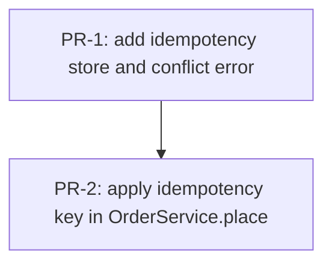

# PR plan: add idempotency key to OrderService.place

Plan: `docs/jstack/order-idempotency-key/implementation-plan.md`
Budget: 500 changed lines per PR, tests included

## Stack overview

| ID | Title | Depends on | Changes | Est. LOC | Kind |
|---|---|---|---|---|---|
| PR-1 | feat(order): add idempotency store and conflict error | - | C-2, C-3, C-4 | 150 | scaffold |
| PR-2 | feat(order): apply idempotency key in OrderService.place | PR-1 | C-1 | 120 | wiring |

Estimate basis: PR-1 adds 2 methods and 1 error class at 8 lines each, 24 lines, plus 1.5x for the 5 store and error cases, 36 lines, plus module scaffolding and fixtures, rounded up to 150. PR-2 modifies 1 method at 4 lines plus 2 private helpers at 8 lines each, 20 lines, plus 1.5x for the 3 service cases, 30 lines, plus the test fakes, rounded up to 120.

## Dependency graph

## PRs

### PR-1: feat(order): add idempotency store and conflict error

**Goal.** Add the store that looks up and records a result per key, and the error raised when a seen key arrives with a different payload, with no caller yet.

**Changes.** C-2, C-3, C-4

**Files.**
- `scripts/lib/idempotency-store.mjs`
- `scripts/lib/idempotency-conflict-error.mjs`
- `scripts/lib/idempotency-store.test.mjs`

**Tests.**
- `scripts/lib/idempotency-store.test.mjs` asserts that lookup returns null for an unseen key and after expiry, that lookup returns the stored result and hash for a recorded key, and that record sets expiresAt 24 hours ahead
- `scripts/lib/idempotency-store.test.mjs` asserts that the conflict error has code IDEMPOTENCY_CONFLICT and exposes key, storedHash, and newHash

**Verify.** `node --test scripts/lib/idempotency-store.test.mjs`

**Review focus.** The store contract. An expired entry must read as null, and record must overwrite nothing it did not write itself.

**Observable.** Nothing yet. The store has no caller, so no order path changes.

**Rollback.** Revert the merge commit. No data or config is written.

### PR-2: feat(order): apply idempotency key in OrderService.place

**Goal.** Look the key up before saving so a replayed request returns the stored result and a changed payload under a seen key raises the conflict error.

**Changes.** C-1

**Files.**
- `scripts/lib/markdown.mjs`
- `scripts/lib/order-service.test.mjs`

**Tests.**
- `scripts/lib/order-service.test.mjs` asserts that place saves once for a fresh key, replays the stored result for a seen key with the same orderId, and throws the conflict error on a seen key with a new payload without touching the repository
- CT-1, CT-2 in `scripts/lib/orders-http.component.test.mjs`: the four scenarios over the real routing with the store fake and the repository stub
- BB-1 in `scripts/blackbox/orders.bb.test.mjs`: the four scenarios against the booted app with the key store stub server

**Verify.** `node --test scripts/lib/order-service.test.mjs scripts/lib/idempotency-store.test.mjs scripts/lib/orders-http.component.test.mjs && node --test scripts/blackbox/orders.bb.test.mjs`

**Review focus.** The order of operations in place. The lookup must happen before the repository save, the replay branch must return before any side effect, and record must run only after a successful save.

**Observable.** A caller that retries place with the same key receives the original result and no duplicate order is saved. A retry with a different payload fails with IDEMPOTENCY_CONFLICT.

**Rollback.** Revert the merge commit. Entries already recorded by the store stay unused and expire on their own.

## Sequencing rationale

PR-1 lands the store and the error with their unit tests and no caller, so it is reviewable on the contract alone and deployable without a behaviour change. PR-2 writes the failing service test first, then the change to place that makes it pass, and carries the component and blackbox tests because the scenarios only become reachable when place applies the key. The order path changes only in the last PR, so a rollback of PR-2 alone restores today's behaviour while PR-1 stays merged.
