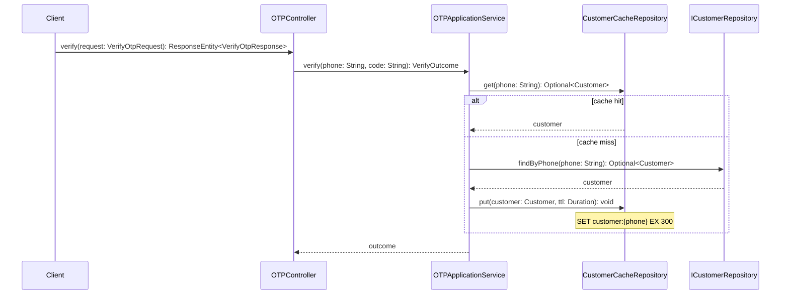

# Sequence diagrams at method level

A jstack plan uses sequence diagrams as its primary design surface. A reviewer reads them instead of prose. These rules keep them precise enough for an agent to code from and short enough for a human to review.

## Rules

1. **One diagram per flow.** The happy path of one use case is one diagram. Each error or alternative path that changes which methods run is its own diagram, or an `alt` block when it stays under five messages. Name each `### SD-n: <caption>` where the caption is a verb phrase such as `Verify OTP and sign in`.
2. **Participants are real names.** Declare each participant with the class or module name from grounding, for example `participant OTPController` or `participant OTPApplicationService`. External systems get their plain name such as `participant Redis` or `participant MySQL`. The caller is `participant Client` for HTTP and `participant Job` for scheduled work.
3. **Every message is a method call with its signature.** Write `A->>B: methodName(param: Type): ReturnType`. Use the real signature from the code for existing methods. For a new method, use the signature the change table declares. The method name before `(` must match the change table exactly, because the checker cross-references them.
4. **Returns only when they matter.** Use `B-->>A: value` when the returned value drives the next decision. Skip it otherwise.
5. **Branches use `alt`, `else`, `opt`, and `loop`.** Label the condition in the business language, for example `alt otp expired`.
6. **Side effects are notes.** A database write, a cache set, an event published, an email sent is `Note over B: writes otp_attempts row` or `Note right of B: emits CustomerVerified`.
7. **Keep it under 25 messages.** Split a longer flow into two diagrams with a shared boundary participant.
8. **New things are visible.** List the new or changed methods under the diagram in one line, for example `New: OTPApplicationService.findCachedCustomer, CustomerCacheRepository.get`. Do not decorate arrow text.
9. **No implementation inside arrows.** Loops over collections, null checks, and logging stay out unless they change which participant is called.

## Minimal example

New: `CustomerCacheRepository.get`, `CustomerCacheRepository.put`.

## Review checklist

- Can an engineer open each participant's file and find each method named? If not, the diagram is a sketch, not a plan.
- Does every `C-n` row that adds or modifies a method appear in at least one diagram? The checker enforces this.
- Is there a diagram for the error path the requirement cares about?
